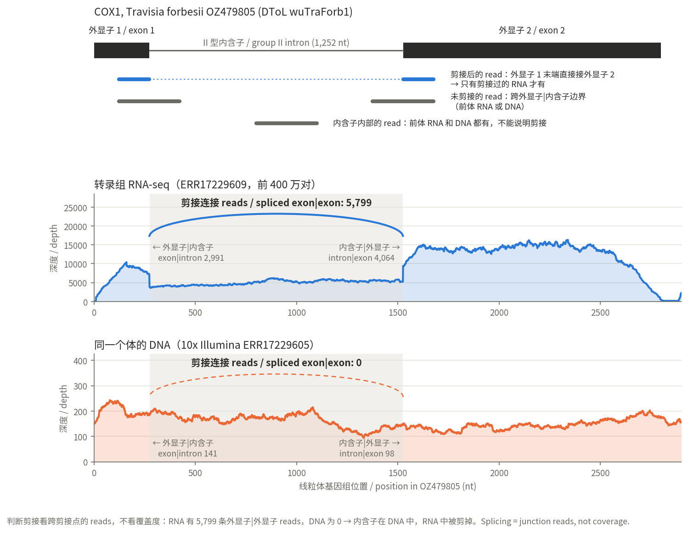

# Annelid genome-project mitogenomes annotated with their own RNA-seq (2026-11-10/11, cody)

问题：NCBI 上环节动物全基因组项目（多为 DToL / ERGA 长读长组装）的线粒体基因组，几乎都没有注释。用 MitoM 注释后，
再用同一基因组项目的转录组核对、修正，能得到一批多准确的注释？
Question: annelid genome-project mitogenomes (long-read assemblies, mostly unannotated): annotate with MitoM, then check
and correct with the same project's RNA-seq.

## Data / 数据（每一对的全部登录号在 `datasets.tsv`）

1. 清单：`ncbi-genome-inventory Annelida`（用户工具）。配对只用它推导的关联：线粒体基因组 `relation_derived`
   （in_assembly / same_biosample）对应 RNA run 的 `linked_assemblies_derived` 与 `specimen_derived`
   （`select_pairs.py`）。不按物种名配对。候选 run 全部列在 `candidates.tsv`。
   Pairs only through the inventory's links (`select_pairs.py`); never by species name.
2. 每个线粒体基因组选一个 run：同一标本 > 同项目不同标本 > 同项目、标本未知；再选 PolyA 建库、双端、数据量大的。
3. 获取：`organise-sra locate` 先查本机与局域网服务器（cody + deyuan112），已有的从 deyuan112 取前 800 万对
   （局域网 100 Mbit/s），其余 `organise-sra download` 经 direct-download 直连下载（整个 run）。来源写在
   `results.tsv` 的 `reads_source`。
4. 注释：`mitom run --clade Annelida-segmented-worms`（MitoM c1d29e5 之后的版本）；转录组证据：`mito_rna.py`
   （bwa mem，`../rna_mappers_2026-11-10/`）；写回注释：`mito_rna.py --refine --run <run>`。

| 配对级别 / link level | 对数 / pairs | reads 与线粒体基因组差异中位数 / median edit rate | 最大 / max | 标记 / flagged |
|---|---|---|---|---|
| 同一标本 / same specimen | 30 | 0.35 % | 1.08 % | 0 |
| 同项目不同标本 / same project, other specimen | 22 | 0.45 % | 7.69 % | 2 |
| 同项目、标本未知 / same project, specimen unknown | 2 | 0.81 % | 0.81 % | 0 |

## Species check / 物种核对

同一基因组项目的转录组与线粒体基因组应是同一物种：reads 差异 > 2 % 标为 FLAG（污染或样品标错，也可能是隐存种），
其表达和 3′ 端不使用。标记的 2 对都是蚯蚓（正蚓科）、同项目不同标本：*Aporrectodea caliginosa* OZ374031 /
ERR13621440、*Lumbricus terrestris* OX457054 / ERR12642427（差异见 `results.tsv`）。这两个种都是已知的隐存种复合体，
需要分类学判断。
Same project should mean same species: > 2 % divergence is flagged (contamination, mislabelled sample, or a cryptic
species); the two flagged pairs are earthworms of known species complexes.

## Results / 结果（52 对通过物种核对，52 种 / 52 pairs pass）

| 蛋白基因 3′ 端 / PCG 3′ ends (673) | 数目 / n |
|---|---|
| poly(A) 正好在注释末端（±10 nt）/ at the annotated end | 464 |
| 完整终止密码子后 11–30 nt 结束（短 3′ UTR，中间无其他基因）/ after a complete stop (short 3′ UTR) | 15 |
| 末端被修正 / end moved | 4 |
| 序列在记录中重复，深度不可测 / duplicated in the record | 5 |
| 无 poly(A) 证据 / no evidence | 185 |

无证据最多的是 ND4L（52 种中 50 种）：ND4L 与 ND4 共用一个转录本，自己没有 poly(A)，这是正常的；其次 ATP8、ND6
（表达低、短）。rRNA 3′ 端：104 个中 88 个被确认，1 个修正。
Most unconfirmed ends are ND4L (shares its transcript with ND4) and short, weakly expressed genes.

修正 / corrections（`--refine`；每个都与同科已注释蛋白的中位长度一致）:

| 线粒体基因组 / mitogenome | 物种 / species | 基因 / gene | 改动 / change | poly(A) reads | 同科中位 / family median (aa) |
|---|---|---|---|---|---|
| CM084515.1 | *Whitmania pigra*（同一标本） | ND6 | 177 → 152 codons，止于 TA | 18 | 152 |
| OZ404008.1 | *Sclerolinum annulatum* | ND2 | 339 → 331，止于 TA | 107 | 331 |
| OZ204559.1 | *Sabella spallanzanii* | ND1 | 300 → 305，延伸到 T | 17 | 305 |
| OZ204559.1 | *Sabella spallanzanii* | ND3 | 115 + TA（原无终止密码子） | 29 | 115 |
| OZ204559.1 | *Sabella spallanzanii* | rrnL | 3′ 端移 11 nt | 1,978 | — |

*Sabella* 的 ND1、ND3 和 *W. pigra* 的 ND6，MitoM 原本都标为 "stop codon not determined"：转录组正好补上了 MitoM
定不了的末端。MitoM had left three of these ends open ("stop codon not determined"); the RNA-seq closes them.

## What clean data teach / 干净数据学到什么（`clean_pairs.txt`，23 对）

先只用不会误导的数据：同一标本、reads 差异 < 1 %、PolyA 建库、蛋白基因深度 ≥ 100×、poly(A) reads ≥ 1,000、
13 个蛋白基因齐全、无重复序列（排除 31 对：不同标本 24、poly(A) 太少 8、非 PolyA 5 …）。
Clean pairs only: same specimen, < 1 % divergence, poly(A) library, depth >= 100x, >= 1,000 poly(A) reads, 13 genes.

| 问题 / question | 结果 / result |
|---|---|
| poly(A) reads（非内部引发）停在哪里 / where poly(A) reads end | 蛋白基因 3′ 端 41.1 %，rRNA 3′ 端 47.4 %，tRNA 0.1 %，其他 11.4 % |
| MitoM 注释为不完整终止 T / TA 的基因 / genes annotated with T / TA | 63 / 63 的最强位点就在注释末端（0–2 nt） |
| 有自己 poly(A) 末端的比例 / genes with their own poly(A) end | ND1、CYTB 23/23 … ATP8 18/22；ND4L 3/23（17 种与 ND4 重叠，同一转录本） |
| 表达排序在物种间的一致性 / expression ranking between species | Spearman 中位数 0.82（COX1–3 > ATP6、CYTB > ND 基因 > ATP8） |

完整终止密码子附近的 146 个强位点（≥ 10 reads）/ the 146 strong sites at complete stop codons:

| 情况 / case | 位点 / sites | 转录本末端 / transcript end |
|---|---|---|
| 不与下游重叠 / no overlap | 71 | 终止密码子后几个 nt（短 3′ UTR） |
| 不与下游重叠 / no overlap | 14 | 正好在终止密码子 |
| 与下游 tRNA 重叠 / overlaps a tRNA | 27 | 在 tRNA 起点切开，留 T / TA |
| 与下游 tRNA 重叠 / overlaps a tRNA | 23 | 保留完整终止密码子 |
| 与下游蛋白基因重叠 / overlaps a protein gene | 8 | 在下游基因起点切开，留 T / TA |
| 其他 / other | 3 | — |

结论：转录组有用，且信号干净——注释与 poly(A) 大多一致，MitoM 的不完整终止全部被证实，表达排序可重复（可用来
判断 ORF）。转录组真正能补上的是基因组本身定不了的末端：终止密码子与下游 tRNA 重叠时，转录本是在 tRNA 前切开
（T / TA）还是保留完整终止密码子，两种都常见，只有 poly(A) 位点能逐个确定。
RNA-seq is useful and clean; what it adds is the end the genome cannot decide: where a stop codon overlaps the next
tRNA, the mRNA is cut before the tRNA (T / TA) about as often as it keeps the full stop.

## Introns / 内含子（reads 中直接数 30 nt 探针，两条链，不用剪接比对）

| 记录 / record | run | 基因 / gene | 内含子 / intron (nt) | 剪接连接 / spliced | 外显子\|内含子 | 内含子\|外显子 | 结论 / verdict |
|---|---|---|---|---|---|---|---|
| OZ352441.1 *Chaetopterus dewysee* | ERR12342473 | COX1 | 320 | 102,944 | 2,364 | 7,557 | 成立 / confirmed |
| OZ210882.1 *Glycera fallax* | ERR13385673 | COX1 (1) | 2,468 | 4,895 | 361 | 395 | 成立 |
| OZ210882.1 *Glycera fallax* | ERR13385673 | COX1 (2) | 2,346 | 12,769 | 481 | 6,587 | 成立 |
| OZ479805.1 *Travisia forbesii* | ERR17229609 | COX1 | 1,252 | 83,887 | 44,024 | 60,269 | 成立（大量未剪接前体） |
| OZ479805.1 *Travisia forbesii* | ERR17229609 | ATP8 "1 nt" | 1 | 0 | 533 | 677 | 不成立：RNA 保留该碱基 / not an intron |

### 怎么用转录组判断剪接 / how to judge splicing from RNA-seq



- 直接比对时，内含子区域也有覆盖：未剪接的前体 RNA 覆盖整个内含子，所以**覆盖度不能说明是否剪接**（上图 RNA 面板，
  内含子深度约 5,000×）。Coverage alone cannot show splicing: precursors cover the intron.
- 判断剪接看**跨剪接点的 reads**：read 的序列从外显子 1 最后一个碱基直接接到外显子 2 第一个碱基（图中蓝色 read）。
  这种 read 只能来自剪接过的 RNA。数法：在 reads 里直接找外显子|外显子的 30 nt 序列（两条链），不依赖比对软件
  （剪接比对软件会报假内含子）；同时数外显子|内含子、内含子|外显子作对照（`travisia_dna_check.py`）。
  Splicing = junction reads (exact exon|exon sequence in the reads), counted without a spliced aligner.
- 用同一个体的 DNA 作阴性对照：DNA 中外显子|外显子必须为 0，否则可能是 DNA 本身有缺失型变异（异质性），不是剪接。
  DNA of the same specimen must have no exon|exon reads; otherwise a deletion variant in the DNA could explain them.
- 本例：RNA 5,799 条外显子|外显子（前 400 万对；整个 run 83,887 条），DNA 0 条 → 内含子在 DNA 中、在 RNA 中被剪掉；
  同时仍有约 3,000–4,000 条未剪接 reads，即部分转录本尚未剪接。重画：`python3 figures/make_travisia_cox1_splicing.py`。

**只用转录组、不用注释，如何证明有内含子 / proving an intron from RNA-seq alone, without any annotation**

| 证据 / evidence | 本例 / here | 说明 / meaning |
|---|---|---|
| 分段 reads（split reads）都跳过同一段基因组 | RNA 中 4,883 条分段 reads，4,825 条（98.8 %）精确跳过 274..1525（1,252 nt）；其余只差 1–5 nt | 决定性：许多独立 reads 在同一对碱基处断开、接上 = 内含子及其精确边界 |
| 同一个体 DNA 的分段 reads | 48 条，零散，无一在此处 | 排除 DNA 本身有缺失（异质性） |
| 剪接后是否得到完整蛋白 | 外显子 1 + 外显子 2：515 aa，无内部终止 | 剪接产物有功能意义 |
| 边界序列 | 5′ `GCGCGC…`（非典型 GUGYG），3′ `…AT`（符合 AY） | 与“退化的 II 型内含子”一致（Kobayashi et al. 2022） |
| 内含子内的读码框 | 从外显子 1 读进内含子，508 个密码子无终止 | 内含子带一个与外显子 1 同框的 ORF（可能是成熟酶 ORF）：未剪接转录本会翻译成融合蛋白 |
| 切下的内含子（环 / 套索） | 0 条 | PolyA 文库不富集切下的内含子，预期如此 |

方法：分段 reads 取 bwa mem 的主比对 + 补充比对（SA 标签，同链，MAPQ ≥ 20），记录两段之间跳过的基因组区间并计数；
不需要剪接比对软件，也不需要任何注释。Split reads (primary + supplementary, same strand, MAPQ >= 20), gap tallied.

## mito_rnaseq_annot.py：把学到的经验做成一个算法 / the learned rules as one algorithm (2026-11-11)

独立模块（不改 `mitom run`，也不改 `mitom rna`）：输入已注释的线粒体基因组 + 同一标本的转录组，输出
`rnaseq_evidence.tsv`（每个判断一行：步骤、基因、结论 confirmed / corrected / flagged / not_testable、依据）和
`rnaseq_annotated.gb`。A separate module: annotated mitogenome + RNA-seq of the same specimen -> evidence table and
revised GenBank; every decision labelled.

```bash
python3 mito_rnaseq_annot.py -g annotated.gb -1 R1.fq.gz -2 R2.fq.gz -o out --run SRR... --threads 16
```

| 步骤 / step | 规则（来自哪批数据）/ rule (learned from) |
|---|---|
| 0 质控 / QC | reads 差异 > 2 % 停止（同标本 ≤ 1.08 %）；poly(A) reads < 100 不判 3′ 端；序列重复的基因不判表达 |
| 1 内含子 / introns | 分段 reads 全基因组盲找；未注释的连接需 ≥ 10 reads 且 ≥ 20 % 侧翼深度（4 个真内含子 0.66–1.38，311 个噪声中 305 个 < 1 %）；跨环状原点的 join 不算；1 nt 的 join = 移码拼接：查 RNA 是否保留该碱基，并找另一读码框的完整 ORF |
| 2 重叠终止 / overlapping stop | 终止密码子与下游基因重叠 ≥ 3 nt 时，poly(A) 位点（观察到的位置）决定在下游基因前切开（T / TA）还是保留完整终止 |
| 3 3′ 端 / 3′ ends | `mito_rna.refine`：确认、3′ UTR、截短、延伸、rRNA |
| 4 RNA 与基因组不一致 / RNA ≠ genome | 插入 / 缺失 ≥ 20 %：20–79 % 为部分转录本（滑动 / 异质性），≥ 80 % 为组装碱基错误或多态；只标记，不改序列 |
| 5 表达 / expression | ORF 与短基因（ATP8 / ND4L / ND3）比，不与 13 基因中位数比 |

结果（54 对；学习集 = `clean_pairs.txt` 的 23 对，测试集 = 其余 31 对）/ results:

| 步骤 / step | 结论 / verdict | 学习集 / learning | 测试集 / test |
|---|---|---|---|
| 0 | 物种核对 / species check flagged | 0 | 2 |
| 0 | 序列重复 / duplicated: not testable | 0 | 5 |
| 1 | 内含子确认 / intron confirmed | 4 | 0 |
| 1 | 移码拼接 / frameshift join flagged | 3 | 0 |
| 2 | 重叠终止修正 / overlap cut corrected | 8 | 8 |
| 3 | 3′ 端修正 / 3′ end corrected | 3 | 1 |
| 4 | RNA 插入缺失 ≥ 80 %（蛋白基因内）/ near-all indel in a protein gene | 12 | 3 |
| 4 | RNA 插入缺失 20–79 %（蛋白基因内）/ partial indel in a protein gene | 4 | 10 |
| — | 修正后蛋白与同科中位长度相差 ≤ 2 aa / corrected protein within 2 aa of the family median | 10 / 10 | 8 / 8 |

每条判断：`rnaseq_annot_summary.tsv`（修正与标记，含同科中位长度）。迭代：v1 未注释连接 314 个几乎全是噪声
（→ 侧翼深度比例）；v2 深文库被误判“无 poly(A)”（Sabella 3,878 / 4,050 万 reads → 改为绝对数）、跨原点 join 被当作
内含子、重叠切点用了计算位置而非观察位置（Sclerolinum ND2 差 1 nt）。下一步：步骤 4 中同标本 ≥ 80 % 的蛋白基因内
插入缺失（12 处）用 DNA reads 核实是否为组装错误。
Iterations: v1 314 junction calls, nearly all noise; v2 deep libraries judged without poly(A), origin joins as introns,
computed instead of observed cut. Next: check the 12 near-all coding indels with DNA reads (assembly errors?).

### 与 MITOS2、MitoM 比较 / compared with MITOS2 and MitoM (2026-11-11)

同一批 52 条（物种核对通过；学习集 23、测试集 29）；MITOS2 2.1.9 由 `mito_bench_run.py --tools mitos2`（refseq89m）
注释，坐标映射到 MitoM 的旋转后坐标；评价标准不依赖被评方法（蛋白长度与同科中位数、内含子用分段 reads 证实的坐标），
3′ 端 poly(A) 支持对 MITOS2、MitoM 是独立检验，对 MitoM + 转录组部分循环（它把末端移到 poly(A) 处）。
`compare_tools.py`，每条记录：`tool_compare.tsv`。Same 52 records; MITOS2 mapped to MitoM coordinates.

| 指标 / measure | 集合 / set | MITOS2 | MitoM | MitoM + 转录组 / + RNA-seq |
|---|---|---|---|---|
| 找到的蛋白基因 / protein genes found | 学习 / learning (23) | 298 | 299 | 299 |
| | 测试 / test (29) | 368 | 372 | 372 |
| 蛋白与同科中位数相差 ≤ 2 aa / within 2 aa of the family median | 学习 | 167 / 259 | 202 / 260 | 204 / 260 |
| | 测试 | 175 / 292 | 231 / 295 | 233 / 295 |
| 3′ 端有 poly(A)（≥ 3 reads，末端 −10 至 +30 nt）/ 3′ end with poly(A) | 学习 | 189 | 253 | 253 |
| | 测试 | 183 | 252 | 254 |
| 已证实内含子坐标精确 / RNA-proven introns with exact ends | 学习 (4) | 0 | 4 | 4 |

**MITOS2 加上 MitoM 的修正是否就一样？/ is MITOS2 equal once MitoM's curation is applied?** 不一样。
`mito_bench_run.py --tools mitos2_cur`（MITOS2 结果经 `mitom import` 边界修正；内含子、补漏、rRNA HMM 关闭）和
`mitos2_full`（`mitom import` 默认：MitoM 之后的全部步骤）：

| 测试集 / test (29) | MITOS2 | + 修正 / + curation | + 全部步骤 / + all steps | MitoM |
|---|---|---|---|---|
| 蛋白与同科中位数 ≤ 2 aa / within 2 aa | 175 / 292 | 193 / 295 | 193 / 295 | 231 / 295 |
| 3′ 端有 poly(A) / 3′ end with poly(A) | 183 | 212 | 212 | 252 |
| 已证实内含子（学习集 4 个）/ RNA-proven introns (learning, 4) | 0 | 0 | 1 | 4 |

差距在注释核心给出的基因边界，修正步骤补不回来：ND2（同科中位 ±2 aa：MitoM 22 / 43，MITOS2 + 全部步骤 7 / 43）、
COX1（31 / 17）、ND4（29 / 19）、ND5（31 / 22）；MitoM 对而 MITOS2 + 全部步骤错的基因中，3′ 端不同 59 个、起点不同 34 个。
The gap is in the core's gene boundaries (ND2, COX1, ND4, ND5), which curation does not repair.

**算法本身还是数据？/ algorithm or data?** MitoM 的注释核心与 MITOS2 用同一参考（refseq89m，2018）；后续步骤用到新数据
（pcg_hmm 蛋白库、ORF 库、rRNA HMM、内含子位点库、训练的起始密码子模型）。全部关掉再跑（`--pcg_hmm no --orf no
--rrna_hmm no`，`MITOM_START_MODEL=no`，`MITOM_EXCLUDE_LEVEL=all`，本提交新增的两个基准开关），结果几乎不变：

| 测试集 / test (29) | MITOS2 | MitoM 同 MITOS2 数据 / MitoM, MITOS2's data only | MitoM 完整 / full |
|---|---|---|---|
| 蛋白与同科中位数 ≤ 2 aa / within 2 aa | 175 / 292 | 230 / 294 | 231 / 295 |
| 3′ 端有 poly(A) / 3′ end with poly(A) | 183 | 252 | 252 |
| 已证实内含子（学习集 4 个）/ RNA-proven introns (learning) | 0 | 4（从头预测 / de novo） | 4 |

优势来自算法，不是数据。The advantage is the algorithm, not the newer data.

**还能提高吗？/ can accuracy go further?** 偏离同科中位数 > 2 aa 的 118 个蛋白中，99 个是近缘本身长度不一或仍在近缘
范围内（“± 2 aa”过严）；近缘一致而 MitoM 超出范围的 19 个里，7 个严重截短的基因正好有 ≥ 80 % RNA reads 的插入缺失——
组装碱基错误使读码框断开。*Hermodice carunculata* OZ026631：按转录组共识改 10 处（3 插入、7 缺失）后重新注释，COX3
135 → 259 aa（同科中位 259）、CYTB 无翻译 → 366（376）、ND4 353 → 450、ND6 151 → 158（159），其余 9 个基因不变。
8 条记录有此情况（同标本 5 条：Hermodice、Sabellastarte、Spirobrachia、Lepidonotus、Ridgeia）；Spirobrachia ND6、
Sabellastarte ND3 的“移码拼接”也落在这类位点上。下一步：用同一标本 DNA reads 核实（排除 RNA 编辑），再把“转录组
共识校正序列”作为 mito_rnaseq_annot 的可选步骤。
Of 118 proteins > 2 aa from the median, 99 sit where relatives vary; 7 severe truncations sit on near-all RNA indels
(assembly errors breaking the frame). Hermodice re-annotated after 10 RNA-consensus edits: COX3, CYTB, ND4, ND6 become
full length. Next: confirm with DNA reads, then an optional RNA-consensus sequence correction.

转录组模块在 MitoM 之上的增量小，因为 MitoM 的末端大多已对：它的价值是给每个末端、内含子以直接证据，并改正少数
基因组定不了的末端（20 处，均与同科中位长度一致），以及标出 MitoM 的移码拼接错误和 RNA 与基因组不一致处。
The RNA-seq module adds little to MitoM's counts because MitoM's ends are mostly right already; its value is direct
evidence for every end and intron, the 20 ends the genome alone cannot decide, and the flags.

## Outliers / 异常值分析（如何得到上面的规则）

| 异常 / outlier | 例子 / examples | 原因 / cause | 处理 / rule |
|---|---|---|---|
| 某基因几乎没有 reads（邻近基因很高） | *Themiste lageniformis* OZ077499 的 ATP8、ND6（各出现两次） | 序列在记录中重复（95–100 % 的 25-mer 出现两次），reads MAPQ 0 被过滤 | `duplicated_share` > 0.5：不判断表达，注释加说明 |
| 其他低表达基因（ND6、ND3、ATP8、ND4L，7–226×） | *Pterobdella*、*Branchellion*、*Siboglinum* … | 无重复，真实低表达 + 短片段建库偏差 | 不是注释错误；短 ORF 要与短基因比 |
| poly(A) 在注释末端后 11–30 nt | 27 个，全部有完整终止密码子 TAA / TAG | 短 3′ UTR | 中间无其他基因、≥ 3 reads：算确认 |
| poly(A) 在注释末端之后、基因没有终止密码子 | *Sabella* ND1（GTT 结尾）、ND3 | MitoM 未定末端 | 延伸到留下框内 T / TA 的位点（中间无终止密码子、≥ 10 reads） |
| poly(A) 在注释末端之内 | *Travisia* COX3（原末端已有 3 reads） | 降解 / 加工中间体 | 已确认的末端不移动 |
| rRNA 内部强位点 | *Sabella* rrnL −11 nt（95 % reads）；*Protula*、*Arenicola* rrnL −190 至 −330 nt | 前者为真 3′ 端；后者不明 | 30 nt 内、占 ≥ 90 % 才移动；远处的只报告 |
| 同科一致的高表达（如管栖须腕动物 ND2 17–34 倍） | *Lamellibrachia*、*Oasisia*、*Ridgeia* | 生物学（科内一致） | 不处理 |
| 同项目 reads 差异 > 2 % | 两种蚯蚓 | 污染 / 标错 / 隐存种 | FLAG，不用 |

## Files / 文件

- `select_pairs.py`, `run_rna.sh`, `finish.sh`, `summarise.py`
- `datasets.tsv`：每对的全部登录号（线粒体基因组、BioSample、组装、RNA run、Experiment、BioProject、BioSample、配对级别）
- `candidates.tsv`：所有关联的 RNA run
- `results.tsv`：每对一行，含物种核对、3′ 端、修正、ORF、reads 来源
- `refined_gb/`：52 条通过核对的注释（MitoM + 转录组证据，note 中写明 run）。Refined annotations of the 52 pairs.

Work data on cody: `/media/cody/18T_R1/yzz/_realtest/annelid_rna_2026-11-10/`（`rna_out_v1_species_match/`：
早先按物种名配对的结果，已作废 / an earlier species-name pairing, superseded）。

## Run errors / 运行中的问题

| 问题 / problem | 原因 / cause | 处理 / fix |
|---|---|---|
| 两对 reads 差 8 % | 我自写脚本按物种名配对，绕开了 inventory 的关联 | `select_pairs.py` 只用 inventory 关联；ncbi-genome-inventory issue #2 建议直接输出配对表 |
| GoaT 0 个在测物种 | 经 Clash 代理连接被关闭（直连正常） | ncbi-genome-inventory issue #1 |
| locate 找到 0 个 | `find -xdev` 跳过了各数据盘（独立挂载） | organise_sra issue #4（分支 feat/locate） |
| 局域网拉取只拿到 1 个文件 | `while read` 循环里的 ssh 读走了 stdin | `ssh -n` |
| 等待脚本不结束 | `pgrep -f` 匹配到启动它的命令本身 | 去掉等待，下载完成后再运行 |
