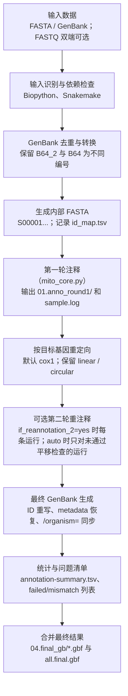
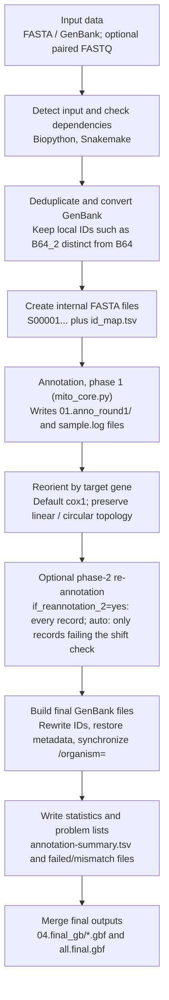

# MitoM 方法与评测 / Methods and benchmarks

MitoM 各模块的方法、设计依据和历次评测（2026-10）。使用方法见 [USAGE_zh.md](USAGE_zh.md)，评测数据在 `../benchmark/results/`。

## 脚本定位 / What The Script Does

`mitom_pipeline.py` 是 MitoM 流程的主程序（命令 `mitom run` / `import` / `annotate` …；旧名 `batch_mitoz.py` 仍可用）：批量线粒体注释（MitoM 核心 `mito_core.py`，或 `--engine mitoz|mitos2`）及作者设计的方向调整、元数据迁回、内含子、端点校正、NCBI 提交文件、基因组圈图等步骤。

`mitom_pipeline.py` is the main program of the MitoM workflow (`mitom run` / `import` / `annotate` ...; the old name `batch_mitoz.py` still works): batch mitochondrial annotation (MitoM's core `mito_core.py`, or `--engine mitoz|mitos2`) plus the author's own steps - reorientation, metadata transfer, introns, curation, NCBI submission files, genome maps and more.

它主要完成：

- 识别 FASTA 或 GenBank 输入。
- 把 GenBank 输入去重并转换为内部 FASTA。
- 为每条记录生成短内部 ID，例如 `S00001`，避免注释核心或 GenBank LOCUS 名称过长。
- 批量调用注释引擎：MitoM 核心 `mito_core.py`（默认），或 MitoZ / MITOS2（`--engine`）；`mitom import` 直接用已有的注释结果。
- 按目标基因重定向序列，默认 `cox1`。
- 可选对重定向后的序列做第二轮注释。
- 把原始 GenBank header metadata 转移回最终结果。
- 修复核心输出中 `FEATURES source` 的 `/organism=`。
- 输出最终 `.gbf`、统计表、日志、失败列表和合并文件。
- 把 ≥ 100 nt、没有任何注释覆盖的区段写成非编码区（NCR）misc_feature（`mito_ncr.py`，见下文）。
- 每条记录画基因组圈图（默认借鉴 mitoPlotR 的环道样式：基因、GC 含量，给 reads 时加测序深度；内含子画斜线并标长度，非编码区画浅灰）。

It can:

- Detect FASTA or GenBank input.
- Deduplicate GenBank records and convert them to internal FASTA.
- Generate short internal IDs such as `S00001`.
- Run the annotation engine in batch: MitoM's core `mito_core.py` (default), or MitoZ / MITOS2 (`--engine`); `mitom import` takes existing results instead.
- Reorient records by a target gene, defaulting to `cox1`.
- Optionally run a second annotation pass after reorientation.
- Restore original GenBank header metadata.
- Restore `/organism=` inside `FEATURES source`.
- Write final `.gbf` files, summary tables, logs, failure lists, and merged GenBank archives.
- Write stretches of >= 100 nt no feature covers as non-coding region (NCR) misc_features (`mito_ncr.py`, below).
- Draw a circular genome map per record (by default in the lane layout of mitoPlotR: genes, GC content, read depth when reads are given; introns hatched with their length, non-coding regions shaded).


## 类群与遗传密码自动判断 / --clade auto (mito_classify.py, mitom_groups.py)

`--clade auto`（默认）逐条记录决定门、类群和遗传密码，结果与依据写入 `reports/clade_decision.tsv`：

1. **GenBank 记录**：分类信息里的门（或纲级同义名）；遗传密码取 CDS 的 `/transl_table`（多数票），没有 CDS 时取参考基因组中该谱系最深一级类群的遗传密码（`code_of_lineage`，例如 Tunicata → 13）。分类信息不属于 Metazoa 时报错。
2. **FASTA / 无分类信息的记录**：blastx（`-query_gencode 5`，任何动物线粒体密码下都不会提前终止）比对 refseq89m 的 8 个保守蛋白（cox1 cox2 cox3 cob atp6 nad1 nad4 nad5，约 8,000 个基因组）。参考基因组的谱系和遗传密码来自 `models/ref_taxa.tsv.gz`（`scripts/build_ref_taxa.py` 用本机 RefSeq 生成，8,022 个中 7,672 个有谱系）。
   - 门：每个基因取前 5 个命中，按（比分 / 该基因最高比分）加权投票；支持度 = 获胜门所占权重。
   - 遗传密码：获胜门的命中的 `transl_table` 加权投票。
   - 密码子核验：在这些比对中，基因组自己的 AGA AGG ATA AAA TGA TAA 处对应的参考氨基酸；每个动物线粒体密码（2 4 5 9 13 14 21 24 33）按吻合比例打分。AGR 在比对区内出现（≥ 1/1000 个密码子且多于 3 倍 TAG）时排除把 AGR 当终止的密码 2（文昌鱼 3.0/1000，脊椎动物 0–0.1/1000）；出现次数不多于 3 倍 TAG（所有密码中的终止密码子，比对区内的 TAG 即测序错误 / 移码的噪声）的密码子不计分。打分明显更好（差 ≥ 0.15）的密码取代近亲的密码，并给出警告。
   - 支持度 < 0.7（参考库里没有近亲，小门常见）：门判为不确定，类群用 `Animal`，遗传密码用密码子核验的结果。
   - 命中少于 2 个基因（< 约 4 kb 的片段）：不判断，并入输入中最常见的组。
3. **多个门 / 遗传密码**：`mitom run` 按（类群，遗传密码，门）分组，每组以显式 `--clade --genetic_code --phylum` 运行一次完整流程（并行；`--jobs` 按记录数分给各组），结果合并到同一输出目录（`final_annotation/`、`summary.tsv`、`ncbi_submission/`、`plots/`、`reports/` 表格合并；各组参数与日志在 `reports/groups/`）。
4. 门未知的记录（FASTA、门不确定）缺 rRNA 时，rRNA HMM 后备步骤使用所有门的模型中得分最高的那一个门。

**评测**（2026-10-31，均为本机数据，未新下载）：

| 测试 | 记录 | 遗传密码正确 | 门 正确 / 不确定 / 错误 |
|---|---|---|---|
| RefSeq 分层抽样（每门 ≤ 15 条 + 各门少数密码 ≤ 3 条，29 门），去掉同科参考 | 238 | 93.3 % | 63.0 / 32.4 / 4.6 % |
| 同上，8 kb / 5 kb / 3 kb 随机片段 | 238 × 3 | 91.6 / 85.3 / 74.4 % | 58.4 / 50.0 / 37.8 % 正确 |
| 同上，10 % / 20 % 随机替换 | 238 × 2 | 89.1 / 84.0 % | 63.0 / 60.9 % 正确 |
| 同上，20 % 的 N（200 nt 块）、反向互补 + 随机起点 | 238 × 2 | 93.3 / 93.3 % | 与完整基因组相同 |
| 全流程：55 条 29 门无标签 FASTA，自身参考在分类和注释中都排除（`MITOM_EXCLUDE_REF`） | 55 | 52 / 55 | 29 / 23 / 3；NCBI ERROR 0 |

门判错的都是参考库里只有 1–2 个科的小门（有爪动物、鳃曳动物、线形动物判成节肢动物）；它们的遗传密码仍正确。遗传密码的残余错误：吸虫 14 → 9（两者只差 TAA）、柱头虫 9 / 24、六放海绵 5 / 4。两个门的嵌合序列判为其中之一或不确定（不报警）。知道类群时请显式给 `--clade` 和 `--genetic_code`。

## 稳健性测试 / Robustness tests (2026-10-31)

- **模糊测试**：19 个命令 × 24 种输入（正常的 GenBank / FASTA / EMBL / 目录，以及空文件、垃圾文本、截断、无 ORIGIN、无特征、gzip、Latin-1、CRLF、蛋白序列、重复登录号、跨起点 / 模糊端点特征、短记录、不存在的路径）：所有命令对坏输入给出一行 `ERROR` 和退出码 2，没有 traceback，也没有"0 条记录"的静默成功（`mitom_work/fuzz_2026-10-31/scripts/fuzz.py`）。
- **坐标变换**：5 条真实记录（内含子、跨起点、反式剪接）× 12 个随机旋转 × 反向互补：每个特征提取出的序列不变（`tests/test_orientation.py`）。
- **校正**：把 55 条 29 门的 MitoM 结果分别旋转到起点落在每个基因内部再校正：基因集合不再变化（修复前 70 例被删、约 25 例被截半）。NCBI NC_001636.1 校正后 13 个蛋白的翻译与 NCBI 完全相同。
- **运行操作**：同一目录重跑、Ctrl-C / kill -9 后重跑、并发运行、threads 与 Snakemake 调度：结果相同；同一输出目录的第二个运行被拒绝（`.mitom.lock`）。
- 四个模块的代码审查报告 32 个问题（另有 2 个附带问题）：29 个复现、修复并加了回归测试（CHANGELOG）；3 个待定：脊椎动物 tRNA 的 L1/L2、S1/S2 命名约定，以及对已校正记录再次校正时起点会变（P11 依赖核心的比对注释）。

## 注释后校正 / Post-annotation curation (mito_curate.py)

对注释好的 GenBank（MitoM 核心、MitoZ、MITOS 等的输出）单独运行，按 Fourdrilis et al. 2018 的软体动物（腹足类）注释准则修正 PCG 与 12S/16S，准则引自 Ghiselli et al. 2021, *Phil. Trans. R. Soc. B* 376:20200159（doi:10.1098/rstb.2020.0159，第 3 节）：

| 规则 | 准则 | 做法 |
|---|---|---|
| P1 | (i) 起始密码子取离上游基因最近且不重叠者 | 起点与上游 tRNA/rRNA 或同框 PCG 重叠 → 后移到第一个起始密码子，但只在 15 nt 内有起始密码子时才移动，否则保留重叠（173 条多类群真值：≤15 nt 的移动对 31 错 12，更远的移动对 14 错 28）；起点放在一个完整同链 tRNA 的上游（基因前三分之一包住整个 tRNA，如蚌类 nad1 包住 trnL2）→ 移到该 tRNA 之后第一个同框起始密码子；首密码子非起始密码子时才向上游找；`--aggressive_start_genes` 列出的基因总是按准则找最上游——默认为空，`mitom run` 只在环节动物 clade 传 `ND5,ND4L`（环节动物 benchmark 7/7 正确；其他类群 173 条里错 52 对 17）；`--aggressive_start` 对所有基因如此 |
| P11 | (i) 的补充：起始密码子的选择 | P1 之后，在 P1 的起点前后 30 个密码子内、读码框连续的所有起始密码子中，取 NCBI 记录会选的那个：梯度提升树（`mito_start.py`，模型 `models/start_model/start_model.json`，纯 JSON 树，不用 pickle）根据密码子、与上游特征的距离及其类型和链、核心工具的比对（N 端缺多少残基、覆盖度）、基因、门打分。训练：1,683 条留一基准记录的候选（`benchmark/train_start_model.py`）。按科交叉验证：起点与 NCBI 完全一致 89.1 → 90.7 %（节肢 77.8 → 82.3 %，刺胞 79.8 → 83.2 %，软体 79.5 → 81.3 %，环节 91.5 → 92.9 %，脊索 97.3 → 97.9 %）；`--start_model no` 关闭 |
| P2 | (ii) 同链同框 PCG 不可重叠（不同框可以，如 atp8-atp6、nad4L-nad4） | 只报告 |
| P3 | (iii) 第一个完整终止密码子，或紧接下游 tRNA 前的 T/TA 不完整终止（tRNA 间断模型） | 完整终止落在下游同链 tRNA 内 ≥3 nt → 截到 tRNA 前并加 `/transl_except` 与 polyA note（真值：伸入 1–2 nt 时 NCBI 保留完整终止 130:57，≥5 nt 时多用 T/TA）；完整终止仅与 tRNA 重叠 1–2 nt 时保留；下游无 tRNA 而完整终止伸入下一个同链蛋白基因 > 30 nt（环节动物 > 10 nt，`--abbreviated_pcg_overlap`，与原点处 O1 一致；atp8-atp6、nad4L-nad4 除外；真值：11–30 nt 内保留完整终止 17:6，更深则 T/TA 为主；本地全部 NCBI 记录中 11–30 nt 的情形：环节动物 T/TA 142:43，刺胞动物 5:109，软体动物 12:66）→ 不延伸：保留原 T/TA 末端（如 cox1→cox2），否则取下一基因前的 T/TA（如 nad6→cob）；核心工具已注释的、伸入下一基因的完整终止不回缩；已是 T/TA 结尾的基因不会为了 90 nt 内的完整终止伸入其他特征（rRNA、反链 tRNA）> 10 nt；注释末端停在第一个完整终止之前、且中间没有任何已注释基因 → 延伸到该终止（≤ 600 nt；核心工具在分化大的类群丢了 C 端同源区：nad5/nad4/nad2/cox1 短 100–500 nt；多类群 benchmark 52 例中 50 例延伸后与 NCBI 完全一致）；会把整个同链 tRNA 包进去、且 tRNA 前没有 T/TA 的基因 → 结束在该 tRNA 之前（3′ partial）；脊椎动物（`--abbreviated_overlap`，`mitom run` 对 Chordata 自动加）：完整终止伸入下游同链 tRNA 1–2 nt 时也改为 T/TA，但伸入下一个蛋白基因时保留完整终止（NCBI 脊椎动物记录 atp6 的 TAA 与 cox3 的 ATG 共用 A；1,719 条留一基准记录只重跑校正：两端一致 17,727 → 17,951，80.0 → 81.0 %；脊索动物多对 294、少对 70，辐鳍鱼 atp6 两种写法都有 104 : 60，鸟类 86 : 2，哺乳类 60 : 2；其他门不变；完全不用该规则 17,373） |
| D1 | — | 同一蛋白基因在不同位置注释两次（MitoZ 遇重复区）→ 只保留完整、较长、靠前的一份；另一条链上与之重叠、不完整或含内部终止的同名拷贝（反义链假阳性）也删除 |
| P7 | — | 起点与终点不在同一读码框（内部终止，NCBI ERROR）→ 取两者中较长的开放读码框：保留起点到第一个终止，或保留终止、在其读码框内取离原起点最近的起始密码子；新 ORF 不足原长一半时不改，只报告（多类群 benchmark：内部终止 14 → 5） |
| P8 | — | 起点与终点同框但有内部终止（起点越过终止子放在上游，或终点越过基因的终止子）→ 取"原起点到第一个终止"与"最后一个内部终止之后的第一个起始密码子到原终点"中较长者（≥ 原长一半） |
| P9 | — | 一个多余碱基不翻译（鸟类、龟类 ND3 第 174 位，Mindell et al. 1998；少数其他基因）→ 按 NCBI 写成 `join(起点..p-1,p+1..终点)` 并加 NCBI 的 note；只在单读码框修正都保不住 85% 基因、且原起止点 30 nt 内有起始/终止密码子能跨过一个碱基构成开放读码框时使用（2026-10 运行：107 个 ND3 中 97 个两端与 NCBI 完全一致） |
| P10 | — | 以上都修不好、仍有内部终止的 CDS → 基因与 CDS 标 `/pseudo`（不翻译），note 写明，需人工核对（table2asn 否则报 InternalStop） |
| O2 | — | 核心工具写成跨原点 join、原点后只有一小段（≤ 300 nt）的 CDS（cox1 在首位时环节动物 nad2 伸进 cox1 却没有终止子，NoStop）→ 截回到序列末端，再由 P1/P3/O1 重新定终止；O1 在原点后 60 nt 内找不到终止、而原点处紧接下一个基因时，读码框内落在序列末端的 T/TA 作不完整终止（NCBI 写法） |
| T1 | — | 完全落在同链蛋白基因内部的弱 tRNA 预测（MiTFi E > 1e-3）：是第二拷贝或位于基因中间三分之一 → 删除（tRNA 是转录本的间断点，同链基因中部不可能有完整 tRNA；table2asn BadCDScomponentOverlapTRNA）；位于基因首/尾三分之一 → 保留 tRNA，由 P1/P3 把基因端点移到它之外（棘头动物 nad6 被延伸到 trnD 内的终止子，NCBI 的 nad6 止于 trnD 之前） |
| C1 | — | 修正后仍完全包住同链 tRNA 的 CDS：无起始/终止密码子或已标 pseudo → 视为假阳性删除（扁形动物"atp8"、毛颚动物"atp6"：这两个门本无此基因）；完整基因只报告 |
| P4 | — | 内部终止密码子、非起始密码子首位、多段/部分 CDS → 只报告，不改 |
| R1 | (vi) rRNA 边界不扩展到两侧基因 | 与两侧 tRNA/CDS/rRNA 的重叠切掉（默认 `--rrna_bounds trim`）；`fill` 再补到两侧基因（空隙 ≤ `--max_fill` 100 nt，GenBank 常见写法） |
| R3 | 命名 | rrnS / rrnL，12S / 16S ribosomal RNA；rRNA 与 CDS 重叠 > 50 nt 报告 |

tRNA 边界保持注释软件结果（准则 v）。每处修改写入 `curation_report.tsv`（规则、旧/新坐标、理由）。

**内置 NCBI 评估**（单独运行 `mitom curate` 时；`mitom run` 不在这里校验，而在第 8 步统一校验并生成提交文件）：有 `table2asn` 时（PATH、`--table2asn` 或 mitointron 环境），每条记录在校正前后各用 NCBI 校验一次，`validation_compare.tsv` 按"记录 + 错误代码 + 特征"列出每类问题 fixed / remaining / new，终端汇总一行（如 `ERROR 128 -> 4 … fixed 124, remaining 4, new 0`）；"new" 即校正引入的新问题，应为 0。`--no_validate` 关闭。

```bash
mitom curate -i annotated_gb_dir -o curated_dir --genetic_code 5 [--rrna_bounds trim|fill]
```

**验证**（31 条鳞沙蚕类真实 MitoZ 注释，/mnt/n/DLC_mt_2023_1016/Mitoz_annotate，对照 NCBI 原记录；坐标换算到 NCBI 序列）：

| | MitoZ 原始 | 校正后 |
|---|---|---|
| PCG 5′ / 3′ 与 NCBI 相同（284 个） | 253 / 211 | **265 / 254** |
| 12S 5′ / 3′（22 个） | 5 / 2 | **17 / 15** |
| 16S 5′ / 3′（22 个） | 0 / 0 | **17 / 11** |
| rRNA 与相邻基因重叠 | 44 | **0** |
| table2asn ERROR | 128（126 个 NoStop） | **4**，全部对应报告中标出需人工检查的 3 个基因（跨原点 cox1、含 24 个内部终止的 COX1、tRNA 前无终止的 ATP6） |

剩余差异主要来自 tRNA 边界与 NCBI 不同（NCBI 的 T/TA 终止落在其 tRNA 前），以及 rRNA 写法惯例（NCBI 多为两侧填满；trim 模式按准则不扩展）。准则来自腹足类，此处在环节动物上验证，软体动物数据尚未测试。

## 非编码区 / Non-coding regions (mito_ncr.py)

每条记录中 ≥ `--ncr_min_len`（默认 100）nt、没有任何特征覆盖的区段写成 misc_feature `/note="non-coding region NCR<k>, <长度> bp: no gene annotated (MitoM)"`：按在记录中的顺序编号，跨原点的写成 join；带内含子的基因覆盖它的内含子；再次运行时替换旧的 NCR。这一步在校正之后（`run` / `annotate` / `import`；`--ncr no` 不写，圈图也不画）。未命名的控制区、可能含未识别基因的序列因此在 GenBank、NCBI 提交文件和圈图里都看得到。

验证（2026-10-30）：22 条 MJ20260820041 记录写出 26 个 NCR，table2asn 0 ERROR，WARNING 与不写 NCR 时相同（18 个）；20 条 NCBI 的 Hesionidae 线粒体基因组 33 个 NCR（24,280 nt），在 NCBI 有注释的记录上，与 NCBI 未注释的区段（如 *Sirsoe methanicola* 2,641 nt，其中一段含 288 个密码子的 ORF）及其控制区特征一致。

## 环状还是线状 / Topology (mitom_topology.py, mito_core.py --check_ends)

**问题**：标签不一定对。本地 NCBI 记录中，669 条环节动物“complete genome”有 64 条标为 linear，1,050 条 RefSeq 完整基因组有 19 条标为 linear，
11 条水母类（线状线粒体基因组）标为 circular；自己组装的序列多条放在一个 FASTA 里又没写 `topology=` 时全按线状处理，起点落在基因中间时这个基因会被拆成两段。

**先试过“全部接起来”（2026-10-30，93 条 NCBI 记录，每条按环状、按线状各注释一次，与 NCBI 比较）**：两种方式蛋白基因两端完全一致的比例相差 ≤ 2 个百分点，
NCBI ERROR 都是 0；结果不同的 20 条中，12 条是 nad2 紧接 cox1 时两条终止规则（序列中间的 P3、原点处的 O1）不一致，与拼接本身无关（已统一，见上表 P3）；
真正与两端有关的 8 条里，拼接更准 3 条、更差 5 条（部分基因组末端被截断的基因被错误地“接”到开头）；全部拼接总用时多 22 %（多搜 3,000 nt、定向后坐标偏移的记录再注释一轮）。
所以不全部拼接，只核对两端。

**两端核对**（`--topology auto`，默认）：先按标签注释（GenBank LOCUS 行；FASTA `topology=`；没有标签时：两端重叠的组装结果去掉重复后为环状，表头写 circular / complete genome 为环状、partial genome 为线状，其余 ≥ 10 kb 的序列（一个文件一条或多条都一样）先按环状注释，再由两端和基因组成决定——没有基因跨两端也没有基因被截断时，蛋白基因 ≥ 12 个且两个 rRNA 齐全为环状，否则为线状；< 10 kb 为线状）。
注释核心对两端的每个蛋白基因（跨原点的，或离序列端点比它缺的残基所需的长度还近的）把序列首尾相接，用该基因的参考蛋白（注释时用的那条）跨接点再比对一次（exonerate）：

| 判定 | 条件 | 含义 |
|---|---|---|
| joined | 参考蛋白跨接点比对，两侧各 ≥ 30 nt；并且两侧各自单独也能比对上、到达接点、残基首尾相接（相差 ≤ 10），或两侧各 ≥ 90 nt、读码框不断、两侧单独的比对不互相矛盾 | 两端是连着的：环状 |
| cut | 比对停在接点 60 nt 内，那一侧缺 ≥ 30 个残基，读码框一直开放到接点 | 基因被端点截断：部分序列，线状 |
| joined_intron | 看似 cut，但用 exonerate protein2genome（允许内含子）在接点前、后剩下的整圈序列上各再比对一次，缺的残基在另一端比对上（中间隔着跨接点的内含子，长度不限） | 两端是连着的：环状；内含子照常注释 |
| complete | 其他：完整基因、N/C 端分化未比对上，或跨接点的比对只是偶然延伸（两侧单独比对接不上又不够长） | 不作判断，按标签 |

有 joined → 环状；标为环状而有 cut → 线状；标为环状的水母类（Hydrozoa、Scyphozoa、Cubozoa、Staurozoa）和钙质海绵（线状线粒体基因组）没有 joined → 线状，
且从第一轮就按线状注释（不必注释两次）；其余按标签。与第一轮拓扑不同的记录用新拓扑再注释一遍；每条记录写入 `reports/topology_decision.tsv`。
MitoZ / MITOS2 / `mitom import` 的注释没有核心的比对证据，按标签。

**校准**（上述 93 条记录各按环状、线状注释一次；28 条记录两端有蛋白基因，共 72 个基因次）：真实环状记录跨两端的基因（NC_035740.1 cox1，参考蛋白在接点前 1,548 nt、后 42 nt）两次都是 joined；
部分基因组末端被截断的 nad2（PQ221480.1，残基 3–114/331）两次都是 cut；其余 68 个（位于两端的完整基因、N/C 端分化未比对上的基因）全部 complete，无误判。
在这 93 条按自己的标签运行（同一版代码，`--topology auto` 与 `label` 同时运行）：82 条按标签，10 条标为 circular 的水母类改为线状，NC_035740.1 因 cox1 跨两端保持环状；
蛋白基因两端一致 82.2 % vs 82.2 %，NCBI ERROR 0 vs 0，总用时 164.2 vs 164.6 分钟（每条中位 95 vs 93 秒）。

**合成检验**（20 条标为 circular 的完整基因组，各门类，2026-10-30）：

| 检验 | `--topology auto` | `--topology label` |
|---|---|---|
| 从一个蛋白基因中间切开、标为 linear（组装从基因中间开始） | 20/20 判为环状 | — |
| ↳ 蛋白基因两端与 NCBI 完全一致 | 78.9 %（与正确标签的原记录相同） | 72.9 % |
| ↳ 漏注蛋白基因 / 有 NCBI ERROR 的记录 | 2 / 0 | 12 / 2 |
| 去掉 1,500 nt（一个蛋白基因的后半段及其后）、标为 circular（部分序列） | 16/20 判为线状，4 条证据不足按标签 | — |
| ↳ 被缺口截断的基因：写成不完整 / 被错误地跨两端接起来 | 16 / 0 | 6 / 2 |
| ↳ 缺口以外的蛋白基因两端一致 | 160 | 159 |

**跨接点的内含子**（2026-10-30）：组装从带内含子基因的第 2 个外显子开始时（环节动物 cox1 的 II 类内含子：MJ20260820041 的 CHY / *Travisia*、CWSC / Nephtyidae），protein2dna 比对不允许内含子，外显子 2 停在接点，原先判为 cut、按线状注释，内含子从未被注释（cox1 只有外显子 2：1,287 或 848 nt）。现在看似 cut 的基因再用 protein2genome 比对（判定 joined_intron → 环状）；从头识别的内含子在跨原点时把描述留在 CDS 上，记录旋转到该基因第一个外显子后恢复内含子特征（`mitom_orient.add_exon_gap_introns`）。22 条 MJ 线粒体基因组：13 条 CHY + 5 条 CWSC 得到 cox1 内含子（用剪接后的蛋白、测序深度、跨接点 reads 以及 LC677172 / *Nephtys* 的 cox1 内含子核实），其余 4 条不变，table2asn 0 ERROR。整段位于接点一侧的 ≥ 6 kb 内含子（六放珊瑚 nad5 内含子 10–12 kb，内含其他基因）原先漏掉，重新比对改为在基因前、后剩下的整圈序列上进行（不限内含子长度）。内含子基准（193 条 NCBI 记录、309 个内含子，刺胞、环节、扁盘、海绵动物；另 76 条无内含子；去掉本属的位点）：把记录旋转到原点落在外显子中、内含子中间或距内含子两端 15 nt 处，得到的内含子与未旋转时相同（300 / 300 行）；修正前原点距内含子右 / 左端 15 nt 时只找到 295 个中的 232 / 190 个。

早期版本的判定（只要求接点两侧各比对上 30 nt）在部分序列上有 5 条误判为 joined（比对偶然越过假接点 35–338 nt），加上“两侧单独比对首尾相接，或两侧各 ≥ 90 nt 且读码框不断”后为 0；
比对在离端点 20–21 nt 处被 exonerate 截短的基因，按“缺的残基放不下”判断是否位于端点，因此仍被检查。

## tRNA 多方法注释 / tRNA (mito_trna.py)

仿 GeSeq（Tillich et al. 2017, NAR 45:W6, doi:10.1093/nar/gkx391）：多个 tRNA 软件结果**全部**写进一个 GenBank（`review/<样本>.gbf`，Geneious 里逐个比较、自己选），另出 `selected/<样本>.gbf`（每位点一个 tRNA）和 `trna_report.tsv`。不预设 tRNA 数目（多数珊瑚 1–2 个，部分环节动物 23–24 个）。

- 软件：MITOS2（只取 tRNA，refseq89m 内置后生动物 tRNA 协方差模型）、ARWEN、ARAGORN、tRNAscan-SE 2（-O）、输入 GB 已有 tRNA。
- 证据按**独立方法家族**计：ARWEN 与 ARAGORN 同作者同算法，算一个。
- 默认选择：MITOS2 找到的采用；MITOS2 没找到的需 ≥2 个独立家族支持。同位点不同反密码子（冲突）保留证据强者，平局都不选。边界取 MITOS2（与 NCBI 完全一致最多）。
- MITOS2 慢的原因：runmitos 对没找到的 tRNA 模型再做灵敏搜索（cmsearch --max、E 0.1、单线程），tRNA 少的类群每条 10 分钟以上并带来假 tRNA。默认 fast 模式（`scripts/runmitos_fast.py`）跳过这一步（一条海葵 640 s → 8 s）；`--mitos_mode full` 恢复。
- 跨原点 tRNA 写成 join。

**用 MITOS2 tRNA 替换现有 tRNA**（`--select mitos2`，可选，不在默认流程中）：

```bash
# 默认流程：mitom run（含端点校正 mito_curate.py 与 NCBI 校验）
# 需要 MITOS2 tRNA 时在 1 与 3 之间插入：
mitom trna -i mitom_out/work/04.final_gb -o trna_mitos2 --select mitos2 --genetic_code 5 \
  --mitos_bin MITOS_ENV/bin --refdir DIR_WITH_refseq89m
mitom curate -i trna_mitos2/selected -o curated --genetic_code 5
```

- 输入必须是**调整方向后的最终 GenBank**（`04.final_gb/`）：MITOS2 在该 GB 自身序列上运行，坐标与其它特征一致；FASTA、`00.*`、`01.anno_round1/`（方向调整前）一律拒绝。
- 只替换 tRNA 及其 gene 特征（命名同核心，如 `trnN(guu)`），PCG/rRNA 不动；review GB 中保留原 tRNA 供对照。
- 某条记录 MITOS2 运行失败 → 该记录原样保留，不会删掉原有 tRNA。

```bash
mitom trna -i gb_or_fasta -o out --genetic_code 5 --tools mitos2,arwen,aragorn,trnascan \
  --bin ENV/bin --mitos_bin MITOS_ENV/bin --refdir DIR_WITH_refseq89m
```

**验证**（裸序列，对照 NCBI tRNA，氨基酸 + 反密码子 + 重叠 ≥50% 算找到；FP = 该处无 NCBI tRNA；`benchmark/eval_trna.py`）：

| | 刺胞/海绵/扁盘 85 条，183 tRNA | 环节动物 RefSeq 40 条，880 tRNA |
|---|---|---|
| MITOS2 | 96.7%，FP 21 | 97.3%，FP 3 |
| ARWEN / ARAGORN | 91.8%，FP 348 / 462 | 95.7% / 96.5%，FP 79 / 117 |
| tRNAscan-SE | 61.2%，FP 1 | 46.1%，FP 0 |
| **默认选择** | **96.7%，FP 21** | **97.5%，FP 3** |

记录清单 `benchmark/trna_sets.tsv`（2026-10-20 重跑）。旧版把 MITOS2 的 `trnM_0(cat)`（同一模型多拷贝）和 `trnQ(---)`（反密码子读不出）丢掉，刺胞 MITOS2 只有 89.6%、默认 93.4%；同一批 85 条修复后 96.7%（另三种工具数字不变，差异全部来自此修复）。

单用 ARWEN/ARAGORN 在 tRNA 少的类群假阳性极多，故只放 review 文件。刺胞的 FP 多来自 MITOS2，是否为 NCBI 漏注未确证。

**原生核心的 tRNA 与 MITOS2 对比（2026-10-27）**：MitoM-ML（MITOS2 tRNA 模型 + 220 个分支协方差模型，ARWEN/ARAGORN 作证据，学习的判别器与端点）＋ MiTFi 二次确认（p < 0.9 的调用须 MiTFi 也调用；同家族较弱的第二个调用须 p ≥ 0.9）＋ 它没调用的 tRNA 家族由 MiTFi 补 ＋ 脊椎动物取 MiTFi 端点。MiTFi 按 MITOS2 的方式运行（E 值按记录长度计算、tRNA 重叠上限 50 nt，与 MITOS2 自己的 MiTFi 输出逐行一致）；唯一不同：快速搜索未找到的 tRNA 模型的灵敏补搜，MITOS2 用 cmsearch `--max` 搜整条序列（每条几分钟），MitoM 用 `--nohmm --F6 3e-4` 只搜蛋白基因 / rRNA 内部以外的区段（基因两端各 100 nt 仍搜）：542 条需补搜的基准记录 CPU 11.9 → 1.0 小时，同骨海绵 NC_014885.1 297 → 18 s（2 线程），召回率和端点不变，只去掉 14 个落在基因 / rRNA 内的弱 MiTFi 调用（NCBI 均无）。所用记录都没有参与训练（无脊椎动物：所在科未参与训练且不在 refseq89m；脊椎动物：模型从未见过；环节动物：只在 GenBank、不在 RefSeq 的记录）；规则在调参的一半上按事先定的标准选定（精确率比 MITOS2 高 ≥ 0.1 个百分点，再取召回最高），另一半只用来检验。召回率 / 精确率 / 两端与 NCBI 完全一致：

| 记录 | MitoM | MITOS2 |
|---|---|---|
| 无脊椎动物 1,043 条 | 98.55 / 99.04 / 86.48 % | 96.59 / 98.79 / 84.63 % |
| 其中从未用来调参的一半 565 条 | 98.75 / 99.06 / 88.70 % | 96.95 / 98.82 / 87.20 % |
| 脊椎动物 188 条（未用来调参） | 98.38 / 98.55 / 92.66 % | 98.31 / 98.24 / 92.61 % |
| 环节动物（纯 GenBank）501 条 | 99.14 / 99.08 / 83.36 % | 97.61 / 99.01 / 81.47 % |
| 其中从未用来调参的 184 条 | 98.90 / 98.72 / 80.20 % | 97.87 / 98.71 / 79.69 % |

按门（无脊椎动物 1,043 条）：节肢、软体、刺胞、线虫、扁形、棘皮、环节等各门三项都高于 MITOS2；棘头动物（4 条）召回持平 45.5%、精确率少 1 个 tRNA（87.0% vs 88.9%），动吻动物（1 条）精确率少 1 个 tRNA。

**完整流程与 MITOS2 的对比（2026-10-27，v30：上述全部规则 + NCBI 提交规则，裸序列输入，与 NCBI 注释逐基因比较；两者都完成的记录）**。蛋白基因（PCG）与 rRNA 为两端与 NCBI 完全一致的比例，tRNA 为召回率 / 精确率 / 两端完全一致：

| 记录 | PCG MitoM / MITOS2 | rRNA MitoM / MITOS2 | tRNA MitoM | tRNA MITOS2 | NCBI ERROR（MitoM） |
|---|---|---|---|---|---|
| 多类群 RefSeq 1,050 条（24 个门） | 84.0 / 59.4 % | 48.9 / 16.9 % | 96.84 / 97.90 / 84.26 % | 95.76 / 97.44 / 83.07 % | 0 条 |
| 环节动物 669 条 | 81.2 / 51.4 % | 32.9 / 12.7 % | 99.12 / 99.13 / 83.45 % | 97.68 / 99.02 / 81.61 % | 0 条 |
| 科未参与训练的无脊椎动物 577 条（不在 refseq89m） | 80.9 / 53.4 % | 33.9 / 19.2 % | 98.76 / 99.06 / 88.70 % | 96.95 / 98.82 / 87.20 % | 0 条 |
| 脊椎动物 188 条 | 88.9 / 72.7 % | 67.6 / 37.0 % | 98.38 / 98.55 / 92.66 % | 98.31 / 98.24 / 92.61 % | 0 条 |
| 锚定基因组 13 条 | 87.3 / 47.9 % | 57.7 / 3.8 % | 98.61 / 98.27 / 86.11 % | 96.88 / 98.24 / 82.64 % | 0 条 |

PCG 两端一致按门（1,050 条）24 个门全部高于 MITOS2；PCG、rRNA 召回也全部更高。唯一不高于 MITOS2 的数字：纯 GenBank 环节动物中从未调参的 184 条，tRNA 精确率 98.70% vs 98.71%（4,000 个调用里多 1 个 NCBI 没有的；其中 43 个与 MITOS2 相同，MitoM 多找到 41 个真 tRNA）；动吻动物（1 条）多 1 个；棘头动物（4 条）召回、精确率持平。报告见 `benchmark/results/full_v30_2026-10-27/`。

ARWEN、ARAGORN、tRNAscan-SE、MiTFi 参数（半全局、重叠、E 值、只按阈值、加分支模型）、多软件投票、重训判别器与端点均测过，见 `benchmark/trna_ml/README.md`。

## intron 注释 / Introns (mito_intron.py, mito_intron_ref.py)

**注释核心不注释 intron（group I / II；MitoZ 也不能）。** `run` / `annotate` 写完最终 GenBank 后分两步补上 intron，并整合进核心结果（`--intron_fix auto`：找到 exonerate+blastp 时运行；`yes` 强制，`no` 关闭；`--intron_bin <env>/bin`）：
1. `mito_intron.py`（从头识别，MFannot 方法，见下）：同源蛋白比对 + 剪接规则定边界；
2. `mito_intron_ref.py`（位点迁移）：内含子位点库 `models/intron_sites.*`（193 条 NCBI 带内含子记录、逐个核实后的 309 个内含子，79 KB）中近缘记录的位点映射到本序列：近缘位点重新定位从头识别的边界，补上从头识别漏掉的（小外显子、反式剪接片段、rRNA 内含子）；库中没有的位点保留从头识别结果。报告 `reports/intron_report.tsv`、`reports/intron_ref_report.tsv`。

### 当前版本（2026-10-29）：核实的金标准 + 位点迁移 / Current version: verified gold standard + site transfer

NCBI 的内含子边界写法因课题组而异（同一位点不同记录可差 1–60 nt，海葵、皮群海葵符合 group I 规则，石珊瑚、角海葵、不少环节动物 group II 不符合），所以先逐个核实本地全部 193 条带内含子的 NCBI 记录（311 个内含子）：剪接后产物（内部终止、起止密码子）、与 12 个他种同源蛋白在拼接点 ±5 aa 内有无插入缺失、group I/II 剪接规则与可滑动窗口、近缘记录同一位点的写法。结果：202 个原样正确，39 个产物相同但边界挪位（改到符合规则的位置），37 个 NCBI 有错且有唯一纠正，16 个证据不足保留 NCBI 写法，2 个 NCBI 内含子特征不是内含子（删除），15 个扁盘动物反式剪接 / rRNA 内含子等只能部分核实；金标准 309 个，其中 97 个位置与 NCBI 不同。详见 `benchmark/results/intron_gold_2026-10-29/`。

真实 `mitom run`（裸序列）对金标准：

| 口径 | 完全一致 | ≤6 nt | >6 nt | 漏检 | 76 条无内含子记录的假阳性 | NCBI ERROR |
|---|---|---|---|---|---|---|
| 默认（完整位点库），194 条 | **309 / 309** | 0 | 0 | 0 | 0 | 0 |
| 留一（本记录不进核心参考和位点库，相当于新物种），270 条 | **299 / 309** | 4 | 0 | 6 | 0 | 0 |
| 留种 / 留属（同一流程输入，只跑内含子步骤） | 296 / 309 | 4 | 3 | 6 | — | — |

留一口径下 A / B / 纠正类全部完全一致（202 / 39 / 37）；差的 10 个是 3 个金标准保留 NCBI 偏离共识写法的珊瑚 nad5 和 7 个库中别无其他记录的扁盘动物反式剪接 / rRNA 内含子。另报出 2 个 NCBI 未注释、很可能真实的内含子（KT989324.1 *Glycera* cox1；丝盘虫 rrnL）。与 NCBI 原注释直接比（311 个）：默认 218 完全一致 / 76 ≤6 nt / 15 >6 nt / 2 漏检（即 NCBI 写错、金标准删除的 2 个）。耗时：从头识别每条 10–20 s，位点迁移 2–5 s。

从头识别（`mito_intron.py`）本轮的改动：跨环状原点的基因在旋转后的副本上建模（原来按 cox1 定向时原点切进 cox1 内含子，环节动物 cox1 内含子因此漏掉一半）；外显子按蛋白顺序串联（刺胞 nad5 的反序片段不再拼成假内含子）；内含子里含有本基因外显子拷贝时拒绝（*Hexamermis* 三个相同 atp6 被拼成 3.7 kb 假内含子）；外显子在两条链上 / 相隔很远的反式剪接基因写成带 `<`/`>` 的部分 CDS；核心的部分基因用核心参考蛋白补搜（*Decemunciger* nad4）；内含子两端可独立微调（按至多 5 个同源蛋白的中位得分）；小外显子插入后两侧内含子重新定边界。`mitom_pipeline` 在内含子步骤后再次旋转，使定向基因的第一个外显子位于序列起点；旋转保留 `<`/`>` 不完整端（此前丢失，反式剪接片段因此出 table2asn ERROR）。

### 从头识别的方法（MFannot 移植）与早期验证（2026-10-09 / 10）/ De novo method and earlier validation

`mito_intron.py` = MFannot（Beck & Lang，https://github.com/BFL-lab/Mfannot ；数据 https://github.com/BFL-lab/MFannot_data ，GPL-3.0；Lang et al. 2023, doi:10.3389/fpls.2023.1222186）intron 流程的 Python 移植，本文件按 GPL-3.0 发布：

| 步骤 | MFannot 对应 | 实现 |
|---|---|---|
| 蛋白库 | protein_collections/identified | 随附 `models/mfannot_proteins/`（313 个基因家族，基因名取自 `mt cox1;` 表头） |
| 预筛 | flip + blast + SelectProteinForExo | ORF ≥40 aa（首个起始密码子起）→ blastp（BLOSUM62，E ≤1e-10）→ 按基因名分组 → 同链相隔 ≥142 nt 的 ≥2 个 ORF 才进入下一步 |
| 基因模型 | FindExonsInHypProtArray / SortAndGroupC4Report | Exonerate protein2genome（minintron 142、maxintron 5000、intronpenalty -35、`models/neutral.pssm`），分数 ≥200 的比对片段按 MFannot 规则串联，可跨越 >5 kb、内含其他基因的 intron |
| 类型 | RNAweasel | Infernal + Rfam RF00028 / RF00029（`models/rfam_group_I_II_introns.cm`） |
| 边界 | Adjust_all_intronic_junctions | ±6 nt 同移，group I（外显子末端 U、intron 末端 ωG）≥19，group II（GUGYG…AY）≥40 |
| 整合核心结果 | — | 基因起止优先采用核心的同框 CDS 端点；无则按同源蛋白延伸到起始/终止（含不完整终止 T/TA） |

与 MFannot 的差异（均写在脚本开头）：类型判定用 Rfam；边界移位以同源蛋白判断（MFannot 以起始模型判断，Exonerate 起始模型错时会拒绝正确边界）；跨环状原点的基因在旋转副本上建模（跨原点的内含子只写在 CDS join 中，table2asn 不接受两段式 intron 特征）；反式剪接基因写成部分 CDS 片段；未移植 MFannot 的小外显子 HMM 步骤。

**验证**（`benchmark/`，2026-10-09）：NCBI RefSeq 中全部带 intron 标注的动物线粒体基因组 85 条（刺胞 82、海绵 2、扁盘 1；真值 138 个 intron = 126 个 intron 特征 + 12 个由 CDS join 推出但缺 intron 特征的），阴性对照环节动物 20 条（含围沙蚕属 4 条）。输入模拟 MitoZ 输出（去掉 intron、拆分基因只留外显子 1）。

| | 完全一致 | ≤6 nt | >6 nt | 漏检 | 多报 | 阴性假阳性 |
|---|---|---|---|---|---|---|
| 真 MFannot（Docker nbeck/mfannot） | 65 | 13 | 7 | 53 | 0 | 0 |
| mito_intron.py | **97** | 23 | 14 | **4** | 1 | **0** |
| mito_intron.py，排除本物种蛋白 | 97 | 23 | 14 | 4 | 1 | 0 |

MFannot 找到的 85 个 intron 中 83 个与本脚本坐标完全相同；MFannot 漏检主要是 >5 kb 的 nad5 大 intron（38 个中漏 38 个，本脚本找到 37 个）。与 NCBI 不一致的 41 处中 19 处 MFannot 与本脚本完全相同（NCBI 边界/终止密码子写法差异）。已知错误：扁盘动物 *Polyplacotoma* 反式剪接 COX1 产生一个 17.7 kb 假 intron（注释带 "UNCONFIRMED … check manually"）；海绵 *Plakinastrella* 两个 intron 间 9 nt 小外显子被合并。**intron 模型仍需人工核对。**

**环节动物**（2026-10-09，NCBI 全部环节动物线粒体全基因组 900 条，去重后 733 条，遗传密码表 5）：环节动物线粒体 intron 主要是 cox1 的 **group II** intron（Rfam RF00029），与刺胞动物的 group I 不同。
- NCBI → 本脚本：NCBI 有 18 个 intron（3 个 intron 特征 + 15 个只体现在 CDS join 中），找到 15 个；漏 3 个（*Decemunciger* ND4 265 nt 断开处，MFannot 亦未检出）。
- 本脚本 → NCBI：21 个预测；3 个对应 NCBI intron 特征，12 个对应 NCBI CDS join，6 个在 NCBI 完全无注释的记录中（*Glycera fallax* ×2、臭海蛹 *Travisia forbesii*、*Chaetopterus dewysee*、*Notomastus* sp. B、*Podarkeopsis*）。
- 与真 MFannot：13 个坐标完全一致（含上述无注释记录中的 6 个里的 5 个，以及臭海蛹 *T. sanrikuensis* / *T. forbesii*）；*Decemunciger* ND1 MFannot 判为 2 个 intron（中间 19 nt 小外显子，本脚本合为 1 个）；*Chaetopterus* 5 个约 300 nt、类型未定的预测 MFannot 未报，**未确证**。
- 臭海蛹属 NCBI 线粒体全基因组 2 条：*T. sanrikuensis* LC677172（cox1 intron 9153..10034，NCBI 9152..10033）、*T. forbesii* OZ479805（NCBI 无注释；cox1 intron 7346..8597，与 MFannot 一致）。

### v5（2026-10-10）：NCBI 提交合规 + 证据门槛

- **NCBI 校验**：`ncbi_validate.py` 把 GenBank 转为 NCBI 提交格式（.fsa + 5 列 .tbl），用 NCBI `table2asn -V vb` 校验（`--only_ours` 只统计本脚本写入的特征）。
- **合规**：新 CDS 带 `/product`（沿用核心，否则标准名）；T/TA 不完整终止带 `/transl_except=(pos:…,aa:TERM)` 与标准 note；3′ 端延伸到阅读框内第一个终止密码子（允许与相邻基因重叠，`--stop_rule first`，默认）。
- **证据门槛**（不依赖 NCBI 原注释）：拼接后 CDS 有内部终止、起始密码子非法、未定型 intron 剪接分数 < 14、或与已有的另一标准线粒体蛋白基因 CDS 冲突（内含子编码 ORF 如 heg 除外）→ 不写入 GenBank，只在 `intron_report.tsv`（`confidence` / `written` / `evidence` 列）中列出。
- **小外显子**：多个同源蛋白在外显子交界处共同显示缺失时，在 intron 内搜索插入后对所有同源蛋白比对都改善的短外显子（MFannot AnnotateMiniExons 思路）。

| 指标 | 刺胞/海绵/扁盘 85 条（138 intron） | 环节动物 733 条（NCBI 18 intron） |
|---|---|---|
| 本脚本写入特征的 NCBI 校验 ERROR | **0**（v3：202） | **0** |
| intron 与 NCBI 完全一致 / ≤6 nt / >6 nt / 漏检 | 98 / 23 / 6 / 11 | 找到 11，漏检 7 |
| CDS 与 NCBI 完全一致 | 99/126（3′ 端 126/126） | — |
| 阴性记录假阳性 | 0 | 写入 16 个：11 个有 NCBI 支持，5 个在 NCBI 完全无注释的记录中（均与真 MFannot 坐标一致） |

与 NCBI 不一致的 28 处 intron 边界，用独立证据（同源蛋白比对得分、group I ωG 规则）判定：13 处两种边界蛋白相同（写法差异），14 处本脚本更好（多为石珊瑚 COX1，NCBI 边界不符合 ωG 规则），1 处 NCBI 更好。NCBI 原记录自身在 table2asn 下也有错误（刺胞 13 个 `MultiIntervalIntron`，环节 1 个 `AbuttingIntervals`），本脚本不照抄 NCBI 坐标。环节动物漏检 7 个：*Decemunciger* ND4 ×3（MFannot 亦漏）、*Chaetopterus* ×4（约 300 nt、未定型、剪接位点弱、MFannot 未报，NCBI 仅以 CDS join 表示；是否为 intron **未确证**，按门槛不写入）。

**近缘参考（借鉴 MitoFinder）**：`--ref_gb <近缘物种 GenBank>`（`mitom run --intron_ref_gb`）把参考 CDS 翻译加入同源蛋白库。MFannot 自带库以真菌/原生生物为主，动物极少、无环节动物，近缘参考可提高环节动物等类群的检出。MitoFinder 本身的 intron 注释只靠 BLASTX 相似性合并片段、不搜边界（其 README 明言），故不替换现有方法。

### v6（2026-10-10）：结构模型扩充 + 裸序列验证

- **类型模型**：Rfam RF00028/RF00029 + 7 个 group II D1–D4 模型（RF01998, RF01999, RF02001, RF02003–05, RF02012；随附）+ Sellés Vidal et al. 2025 的 14 个 group I 亚型模型（IA1–IE3，基于 42,459 个 group I intron 训练，doi:10.1093/bioadv/vbaf020；无许可声明故不随附，首次运行下载到 `~/.cache/mito_intron/`，`--no_subtype_cms` 关闭）。注释写出亚型（如 IB1）。NCBI 真值 intron 判型：刺胞 138 个由 74 → 109 个，环节 27 个不变（18 个 group II）；273 条编码序列 0 误判。
- **起始/不完整 CDS**：首密码子非起始密码子时上游（再下游）搜索起始密码子；阅读框延伸出序列末端时写为 `<`/`>` 不完整 CDS（NCBI 允许），不再因"无起始密码子"丢弃。
- **借鉴 MitoFinder**：`--ref_gb` 近缘参考；外显子总长 ≤ 3×蛋白长+33。
- **其他工具实测/调研**：MITOS2（mamba，refseq89m）在 Metridium 上把 cox1/nad5 注成 -a/-b 片段、外显子边界偏差最多 174 nt、无 intron 特征；在臭海蛹 cox1 上只注出第二外显子。MitoFinder `--allow-intron` 仅按 BLASTX 相似性合并、不搜边界（其 README）。MitoZ、MITOS2、GeSeq、PGA、CPGAVAS2 等均无 intron 模型；目前只有 MFannot/RNAweasel 建模 intron（调研见 benchmark 记录）。

| 验证 | 结果 |
|---|---|
| 刺胞/海绵/扁盘 85 条（138 intron，模拟 MitoZ 输入） | 完全一致 98 / ≤6 nt 23 / >6 nt 6 / 漏检 11（同 v5）；高可信 126、中 3、低 4（v5：105 / 22 / 6）；本脚本写入特征 table2asn ERROR 0 |
| 环节动物 741 条（**裸序列**，去掉全部注释，不用 MitoZ） | NCBI→本脚本：27 个 intron 中完全一致 6 / ≤6 nt 6 / >6 nt 4 / 漏检 11（4 个 intron 伸到片段末端无第二外显子、3 个 *Decemunciger* ND4 与 4 个 *Chaetopterus* 约 300 nt 未定型，MFannot 均未检出）；本脚本→NCBI：写入 21 个，**0 个与 NCBI 矛盾**（8 intron 特征、8 CDS join、5 个在 NCBI 无注释记录中且与 MFannot 一致），全部高可信 |

### v7（2026-10-10）：提速与稳健性

- **瓶颈实测**（cProfile）：v6 的时间几乎全在 cmsearch，且只集中在命中的少数模型（IB3 12 s、RF00028 10 s）；与 intron 长度无关（只扫两端 1.5 kb 不更快，判型也不变）。
- **两步判型**：先用 Infernal `--rfam` 快速过滤，仍未定型的再全灵敏度搜索；同一记录所有 intron 一次调用；只搜正链（`--toponly`）、`--threads` 多线程。165 个 NCBI intron 判型数与大类与全灵敏度完全一致（147/165）。
- **小外显子两步搜索**：先单同源蛋白、交界窗口粗筛，再对前 5 个候选完整验证。
- **稳健性**：外部程序超时（`--timeout`，默认 900 s）不再卡死；单条记录出错不影响整批（原样保留并在报告中注明）；`--jobs N` 多文件并行（mitom_pipeline 传 `--jobs`）。
- **效果**：单记录 *Porites* 42 → 6 s、*Plakinastrella* 103 → 8.5 s、*Travisia forbesii* 4.2 → 1.2 s；全部 846 条验证记录 12 分钟；坐标与 v6 完全相同，判型 +1（NC_040136 nad5，IB1）；测试 464 → 107 s。

依赖：`conda create -n mitointron -c conda-forge -c bioconda exonerate blast infernal biopython`。

```bash
mitom intron -i final_gb_dir -o out_dir --genetic_code 4 --bin /root/miniconda3/envs/mitointron/bin
python3 -m pytest -q tests          # Metridium / Nematostella / Platynereis，排除本物种蛋白
```

## 核基因标记 / Nuclear markers: rDNA and histones (mito_nuc.py)

`mitom nuc annotate` 在 contig（基因组浅测序 / SPAdes 组装、GetOrganelle 组装的 rDNA 单元、PCR 片段、GenBank 记录均可）中注释核 rDNA
（18S、ITS1、5.8S、ITS2、28S）和组蛋白（H1、H2A、H2B、H3、H4，核遗传密码 1），思路同 MitoFinder：用 NCBI 完整注释作参考，
把参考的基因边界通过比对逐列投影到 contig 上。
环状序列（GetOrganelle 结果中名字以 `(circular)` 结尾的路径、GenBank 中 topology 为 circular 的记录）起点任意，可能落在基因中间：
先转到最长的无基因区段（rDNA 单元的 IGS）中点开始再注释，`nuc_annotation.gb` 的定义行注明新起点在原序列中的位置。

```bash
mitom nuc annotate -i scaffolds.fasta -o nuc_out --threads 32            # 默认 --genes rdna,histone
mitom nuc annotate -i my_seqs.gb -o nuc_out --genes rdna
mitom nuc annotate -i get_org_out/anonym.K127.complete.graph1.1.path_sequence.fasta -o nuc_out --genes rdna --organism "Genus species"
# 参考库（随附 models/nuc/，2026-10-23 NCBI）重建或加入自己的注释（如 Geneious 导出的 GenBank）：
mitom nuc fetch -o nuc_refs
mitom nuc build --gb nuc_refs/rdna.gb nuc_refs/histone.gb my_refs.gb -o my_lib
mitom nuc annotate -i scaffolds.fasta -o nuc_out --lib my_lib
```

| 输出 | 内容 |
|---|---|
| `nuc_features.tsv` | 每个特征一行：contig、长度、SPAdes 覆盖度、基因、起止、链、5'/3' 是否不完整、最佳参考及物种、一致度、边界依据（aligned 比对得到 / projected 无比对外推）、`aligned_nt`（参考基因内比对到该特征的 nt，越少越要人工核对）；`copy_ratio`（contig 覆盖度 / 单拷贝覆盖度，后者取 SPAdes contig ≥ 1 kb 的长度加权中位数）；组蛋白另有 `class` / `class_evidence`：`replication-dependent`（串联基因簇拷贝，系统发育常用的 H3/H4：H3 第 31/87/89/90 位 = A S V M，或 copy_ratio ≥ 5）、`replacement`（替换变体：H3.3 = S A I G，或含内含子）、`single-copy`（copy_ratio < 2，如 H2A.X）、空 = 证据不足；序列证据优先于覆盖度 |
| `nuc_annotation.gb` | 有特征的 contig 的 GenBank（rRNA / misc_RNA / CDS，不完整端为 `<` `>`，CDS 带 translation、transl_table 1） |
| `submission/nuc.fsa`、`nuc.tbl`、`nuc.sqn` | NCBI 提交文件：定义行按 NCBI 规范自动生成（如 "... 18S ribosomal RNA gene, partial sequence; internal transcribed spacer 1, 5.8S ribosomal RNA gene, and internal transcribed spacer 2, complete sequence; and 28S ribosomal RNA gene, partial sequence"），来源信息取自输入 GenBank（voucher、isolate、geo_loc_name、collection_date 等）或 `--organism` / `--src`（NCBI source table TSV）；内部说明不写入；rRNA 在负链的序列翻成正向；≥10 N 在 .sqn 中为缺口（100 N = 长度未知）；内部终止的组蛋白写成 gene /pseudo。装有 table2asn 时自动 `-V vb -Z` 校验，结果在 `validation.txt`、`nuc.val`、`nuc.dr`。提交前需加提交者模板（`table2asn -t template.sbt`），NCBI 要求 collection_date 与 geo_loc_name |
| `genes/<基因>.fasta` | 每个拷贝的序列（组蛋白另有 `.faa`） |
| `consensus/<基因>.fasta`、`consensus.tsv` | 每个基因一条序列（GenBank 输入含多个物种时每个物种一条，`sample` 列为物种名）：多拷贝 rDNA 在组装中散成许多 contig 时，片段先在 scaffold 缺口（≥10 N）处切开，高覆盖片段按重叠拼接（拷贝变异分叉处接覆盖度高的一支）、按参考排序（ITS 没有参考，用样本自己的完整拷贝），再按覆盖度加权逐位投票；与共识一致度 < 99 %（`--consensus_identity`）的片段（其他物种、另一种 rDNA、污染）不用，`consensus.tsv` 列出用了哪些 contig、丢了哪些及原因；没有片段覆盖的区段为 N。组蛋白各拷贝是旁系同源，不合并，按 `class` 取一条：基因簇拷贝优先，其次未定、单拷贝，替换变体最后；同类中完整、覆盖度高者优先。SPAdes 常把基因簇拆成 < 150 nt 的高覆盖碎片：此时报告基因簇碎片（标为不完整），而不用完整的单拷贝变体顶替（MJ20260820041 环节动物 6 个组装：旧规则 3 个取到 H3.3、2 个取到基因簇 H3、3 个 H2A 取到 H2A.X）；`consensus.tsv` 的 `class` 列标明所取拷贝的类别 |

大组装先用每属一个 rDNA 单元、每门每种组蛋白一个蛋白做快速预筛，只把命中的区域（±20 kb）送入精细注释：
SRR16188826 SPAdes scaffolds（148 万条、7.2 亿 nt）32 线程 2 分 18 秒。

准确度（`benchmark/nuc_bench.py`，排除同属参考；边界完全一致 / ±5 nt / ±20 nt）：
建库用的 NCBI 378 个物种完整 rDNA 单元 83.2 / 92.7 / 95.2 %（barrnap 0.9 `--kingdom euk` 1.8 / 42.1 / 79.9 %）；
另取不在库里的 71 个物种完整单元作独立测试 42.3 / 82.6 / 90.6 %（barrnap 2.6 / 58.0 / 71.8 %，完全一致率低主要因为占 21 条的一个甲螨研究
有自己的端点约定）。完整组蛋白 CDS 整个模型（起止、外显子、基因名）完全一致：建库集 677 个 97.5 %，独立集 172 个 97.7 %。
另以 RefSeq 精编 rRNA（人、大鼠、猕猴、兔、牛、果蝇、秀丽隐杆线虫）为金标准（`benchmark/nuc_gold_bench.py`）：558 个金标准边界中
NCBI 提交者注释了 9.3 %（其中完全一致 96.2 %），mitom 排除同属参考时全部边界完全一致 85.8 %、±1 nt 94.3 %，在提交者注释过的 53 个边界上
79.2 %（低于提交者）；用完整参考库时 100 %，但此时同种的精编记录就在库里，不是独立检验。库中 28 条精编 rRNA（`build --curated`）比对到边界时
直接决定该边界。
建库时用其他研究的参考交叉检查每条参考的边界，被多数研究否定的边界（如某蜱类研究 28S 3' 端早约 530 nt）不参与投票
（`models/nuc/rdna_qc.tsv`）。边界跟随参考提交者的约定（各研究对 5.8S、28S 端点的约定不完全一致）；参考稀少的类群（海绵、刺胞、粘孢子虫、扁形动物）边界多靠外推，
建议加入本类群的已注释记录。方法与调优记录：`knowledge/topics/nuclear_markers.md`。

rRNA 端点按与实验测定的成熟末端（RefSeq 精编人类等 rRNA）同源的位置确定：先用 BLAST 投影找到基因，再用 Rfam 模型
（RF01960 / RF00002 / RF02543，随附 `models/nuc/rfam/`）精修每个端点——先 profile HMM（快，命中离模型端 ≤3 列且离投影 ≤30 nt 才采用），
其余用协方差模型（±150 nt，命中跑出窗口再 ±600 nt）；模型不能确认且贴着序列末端的端点标为不完整；同种精编参考（≥99.5 %）决定的端点保留。
`evidence` 列：hmm / cm（模型）、curated / aligned / projected（参考）。`--no_cm` 关闭。
独立金标准（RefSeq 精编 rRNA 映射到 8 个物种 336 条记录，558 个边界，排除同属参考，`benchmark/nuc_gold_bench.py`）：精确 96.2 %、±1 nt 99.6 %、
未注出 0.4 %（改动前 85.8 / 96.8 / 1.6 %）；精确不一致的 21 个是秀丽隐杆线虫（模型外侧核苷酸数与哺乳类差 1，排除同属后库中无线虫精编；
线虫 RefSeq 端点为推定值）。CM 金标准（`benchmark/nuc_cm_gold.py`）多鳞虫 + 沙蚕 146 个边界：100 %（与本软件同一模型，循环），
NCBI 提交者 0 %。按提交者注释算（`nuc_bench.py`）一致率下降（38.6 % 精确），原因是各研究的约定不同：如 *Junonia* 18S 5' 端提交者早 4 nt、5.8S 早 6 nt（长型），
mitom 与人类精编同源位置一致。方法与证据：`knowledge/topics/nuclear_markers.md` 第 10、11 节。

低配运行（2 线程，`/usr/bin/time`，2026-10-26）：3 条 contig 4.6 s / 132 MB（1 线程 5.1 s / 101 MB）；61 条 GenBank 23 s / 269 MB；
200 条 rDNA 记录 3 分 6 秒 / 533 MB（优化前 24 分 20 秒 / 2.7 GB）；5.6 Mb 混合输入（走预筛）3 分 25 秒 / 608 MB。

NCBI 提交校验（table2asn 1.28 `-V vb -Z`，2026-10-25）：多鳞虫 + 沙蚕 50 条、23007 3 条 0 条消息；独立 rDNA 898 条本软件写的特征 0 ERROR
（剩 40 个 rRNA 跨越长度未知缺口的 WARNING，与 NCBI 现有记录写法相同；1 个 ERROR 是 NCBI 原记录 source 文字括号不配对）；组蛋白 2012 条 0 ERROR
（修复前 214：负链 CDS 5'/3' partial 标记互换、partial 端未延到序列末端、H1 假内含子、CDS 按 /gene 名连错拷贝），剩 11 个起点不在序列端的 5' partial WARNING（NCBI 标为假基因或 PCR 片段）。

精度（`benchmark/nuc_fp_bench.py`：每个报出的特征是否与记录自身的同名注释重叠，2026-10-25）：独立 rDNA 898 条报出 18S 927 / 5.8S 890 / 28S 895，
未被记录注释的 28S 1 个（鸟类 IGS 中 1.5 kb 类 28S 片段），重复 0（之前 5 个重复、6 个假 28S）；200 条完整线粒体基因组 0 个特征；
2032 条组蛋白记录中 807 个"未注释"的组蛋白经逐条核对 805 个是真基因（提交者只写了 gene 特征或无特征）、名称错 0。
多鳞虫科 / 沙蚕科（NCBI 2026-10-25，排除同属参考）：含 rDNA 的 50 条全部注出；18S 3' 端都在保守的 ...GATCATTA、28S 3' 端都在 ...GATTTGT，
与 NCBI 不一致处多为提交者把 28S 延到序列末端（含 IGS）或 18S 3' 端偏 60–140 nt；5.8S 3' 端与 KY7538xx 等差 7–8 nt（约定差异，未确证）。
沙蚕科 NCBI 没有分段注释的完整单元（只有整段 misc_RNA 的 PP239203 *Perinereis wilsoni*），用 Geneious 注释的 23007-1 对照：
各边界相差 0–3 nt，28S 3' 端 mitom 在保守端 ...GATTTGT，Geneious 早 271 nt。


## GenBank / EMBL 转 NCBI 提交文件 / Submission files (mito_tbl.py, `mitom gb2tbl`)

把任何已注释的 GenBank / EMBL 转成 NCBI 的 5 列特征表 `.tbl` 和带来源修饰符的 `.fsa`（可全部合并、每个文件一对或每条记录一对），并可用 table2asn 生成 `.sqn`。与同类工具比较（2026-10-30）后吸收了它们的长处：GB2sequin（CHLOROBOX）的 EMBL 输入、来源信息表（`--source_table`，即 table2asn 的 `.src`）和产物名表（`--product_table`）；NCBI EDirect gbf2tbl / gbf2fsa 的管道输入、把 DEFINITION 作为 FASTA 标题、每行 70 个碱基。另外：缺 `/product` 的线粒体基因按基因名或 `/anticodon` 补上（CDS 缺产物名是 NCBI 的 ERROR MissingProteinName）；去掉 INSDC 之外的限定词（Geneious、SnapGene、ApE 留下的）和非 ASCII 文字；跨原点、不完整端点照 NCBI 写法；读不了的文件、无序列的记录报告并跳过。来源修饰符名逐个用 table2asn 1.28 核实过（`voucher`、`title`、`definition` 它不认，故分别映射或另作处理）。

**压力测试**（17 个刁钻样例，每个都经 table2asn 判定；`benchmark/results/gb2tbl_stress_2026-10-30/`）：

| 样例 | 考什么 | MitoM gb2tbl ERROR | NCBI gbf2tbl + gbf2fsa ERROR |
|---|---|---|---|
| c01–c03、c09、c13、c14 | 普通记录、内含子、脊椎动物负链、`100^101` 位点、超出末端的特征、怪 ID / 小写 / IUPAC | 0 | 0 |
| c04 / c05 | 跨原点基因（正链 / 负链） | 0 | 2 / 2（SeqLocOrder） |
| c06 | 不完整端点 | 0 | 2（NoStop、SuspiciousFrame） |
| c07 / c17 | 非 ASCII 文字 / Latin-1 编码的文件 | 0 / 0 | 6 / 4（NonAsciiAsn） |
| c08 | 编辑软件导出的私有限定词 | 0 | 4（IllegalDbXref、GeneIdMismatch） |
| c10 | 没有 source、没有物种名 | 0 | 0 |
| c15 | 真实的 ENA EMBL 文件（AF178678） | 0 | 读不了，没有输出 |
| c16 | 编辑软件导出：只有基因名、没有产物名 | 0 | 31（MissingProteinName、TrnaCodonWrong 等） |
| c11 / c12 | 没有序列的记录 / 截断的文件 | 报告并跳过 | 输出坏记录 / 没有输出 |

15 个有效样例 gb2tbl 全部 0 ERROR，gbf2tbl + gbf2fsa 共 51 个；后者的 FASTA 不带 `[mgcode=]`，每条记录另有 13–14 个遗传密码警告。GB2sequin 只有网页版，未实测；Wolflab gb2tbl.py、Loman genbank_to_tbl.py 是 Python 2 脚本，只处理单条记录，不支持不完整端点和多段位置（读代码判断）。

## 流程图 / Flowcharts

已生成以下流程图文件：

- 中文 SVG: [docs/flowcharts/mitom_workflow.zh.svg](flowcharts/mitom_workflow.zh.svg)
- English SVG: [docs/flowcharts/mitom_workflow.en.svg](flowcharts/mitom_workflow.en.svg)
- 中文 Mermaid: [docs/flowcharts/mitom_workflow.zh.mmd](flowcharts/mitom_workflow.zh.mmd)
- English Mermaid: [docs/flowcharts/mitom_workflow.en.mmd](flowcharts/mitom_workflow.en.mmd)
- SVG 生成脚本: [scripts/render_workflow_diagrams.py](../scripts/render_workflow_diagrams.py)

重新生成 SVG：

```bash
python3 scripts/render_workflow_diagrams.py
```

### 中文流程图 / Chinese Workflow



### English Workflow


