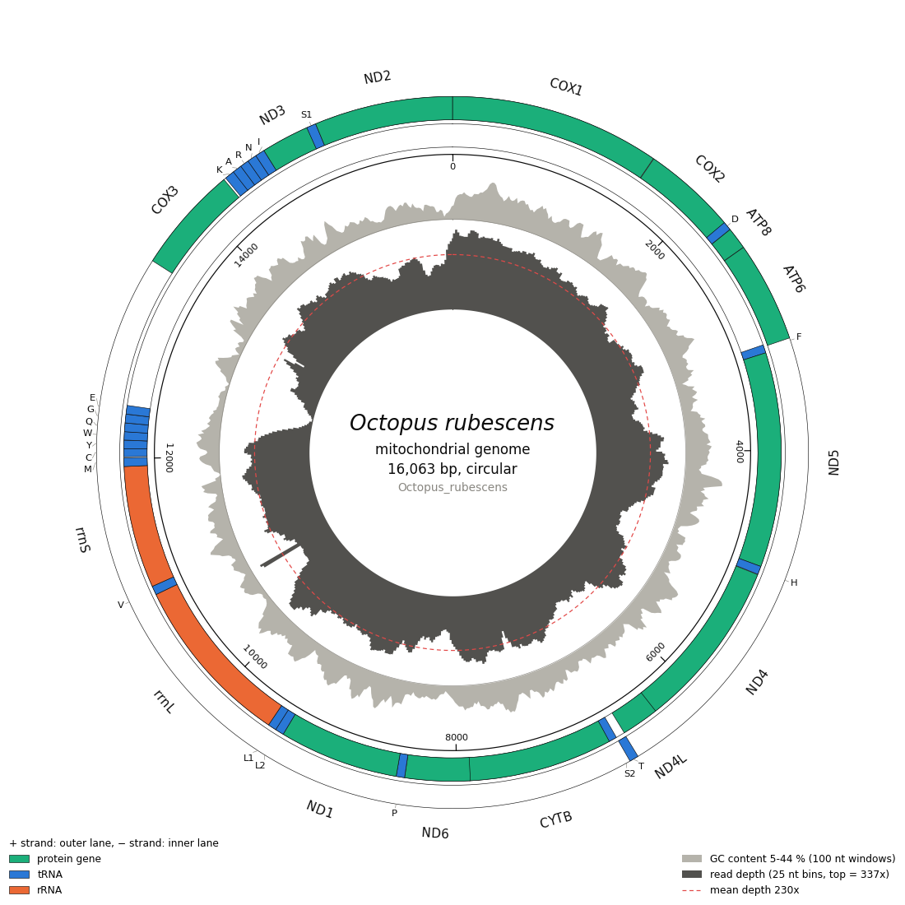
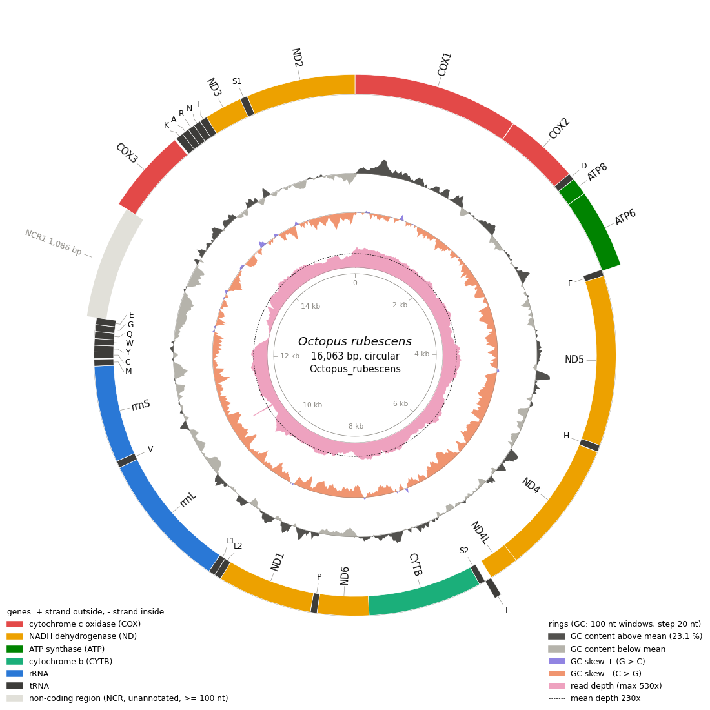

# MitoM 使用手册

> **说明**：MitoM 目前仍在测试中，是本团队内部使用的软件，尚未正式发布。结果（尤其是内含子、tRNA 和基因边界）请人工核对后再用于发表或提交 NCBI。

MitoM（命令 `mitom`）注释动物线粒体基因组：找出 13 个蛋白基因、2 个 rRNA、22 个 tRNA 和内含子，统一方向和起点，按 NCBI 规范修整边界和基因名，生成可直接提交 NCBI 的文件和环状基因组图。另有一个独立功能 `mitom nuc`：在全基因组组装的 contig 中注释核 rDNA（18S–ITS1–5.8S–ITS2–28S）和组蛋白基因。

本手册按使用顺序编排：安装 → 快速开始 → 输入 → 流程 → 各命令 → 输出 → 调试排错 → 常见问题。方法细节与评测见 [METHODS.md](METHODS.md)，版本变化见 [../CHANGELOG.md](../CHANGELOG.md)。

---

## 1. 安装

### 1.1 一键安装（推荐）

需要 Linux 或 Windows WSL2，以及 conda / mamba（推荐 [Miniforge](https://github.com/conda-forge/miniforge)）。

```bash
git clone https://github.com/deyuanyang92-dev/Mitom.git MitoM
cd MitoM
bash install.sh        # 建 conda 环境 mitotools，装 mitom 命令，并运行 mitom setup
mitom doctor           # 检查：必需程序都应显示 OK
mitom --version
```

`install.sh` 做三件事：

1. 按 `env/mitotools.yml` 建一个 conda 环境 `mitotools`：Python 3.11 及 Biopython、numpy、scikit-learn 1.7.2、matplotlib，以及 BLAST+、Exonerate、Infernal、HMMER、ARAGORN、tRNAscan-SE、MAFFT、bwa、NCBI table2asn。MitoM 只用这个环境，不往系统 Python 装任何东西。
2. 安装命令 `mitom`（环境的 `bin/` 和 `~/.local/bin/` 各一个入口）。
3. 运行 `mitom setup`：下载 MITOS2 的参考数据 refseq89m（核对 md5），准备 MitoM-ML 的 tRNA 模型，写配置文件。

Java（MiTFi tRNA 程序用，任何 ≥ 8 的版本）优先用电脑上已有的；没有时 `install.sh` 往环境里加 openjdk 8。

### 1.2 Docker

```bash
docker build -t mitom .
docker run --rm -v "$PWD":/data mitom mitom run -i /data/genomes.gb -o /data/out
```

### 1.3 数据与配置的位置

| 内容 | 位置 | 说明 |
|---|---|---|
| MITOS2 参考数据 refseq89m | `mitom setup --refdir <目录>`；默认 `$MITOS_REFDIR`，否则 `~/mitos_refs` | 注释核心的参考蛋白、rRNA / tRNA 模型 |
| MitoM-ML tRNA 模型 | `$MITOM_DATA`，否则 `$XDG_DATA_HOME/mitom`，否则 `~/.local/share/mitom` | 安装目录可以是只读的 |
| 配置文件 | MitoM 目录下的 `mito_config.json`（`mitom doctor --write-config` 生成） | 记录各程序路径、参考数据目录 |

### 1.4 检查环境：`mitom doctor`

列出每个程序找到的路径、版本，以及哪一步需要它。必需程序缺失时，`mitom run` 一开始就报错并说明缺什么；可选程序（MITOS2、MitoZ、minimap2、ARWEN）缺失时，相应功能跳过并在日志里写明。`mitom doctor --write-config` 把找到的路径写进配置文件。

### 1.5 可选软件

| 软件 | 用途 | 安装 |
|---|---|---|
| MITOS2 2.1.10 | `--engine mitos2`（用 MITOS2 找基因）、`--rescue yes`（补回核心漏掉的基因）、`mitom trna` 的 MITOS2 结果 | `mamba env create -f env/mitos.yml`，或 `install.sh --envs "mitotools mitos"` |
| MitoZ 3.6 | `--engine mitoz`（用 MitoZ 找基因） | 按 MitoZ 官方说明自行安装；MitoM 在 PATH 或 conda 环境里自动寻找，或 `--mitoz_bin` |
| minimap2 | 基因组图的测序深度环（比 bwa 快约 8 倍） | `mamba install -n mitotools minimap2` |

---

## 2. 快速开始

```bash
# 1) NCBI GenBank 记录（含分类信息）：类群和遗传密码自动判断
mitom run -i my_genomes.gb -o out

# 2) 自己组装的 FASTA：需给类群和遗传密码
mitom run -i contigs.fasta -o out --clade Mollusca --genetic_code 5

# 3) 已有的 MitoZ / MITOS2 结果：不重新注释，只做 MitoM 的后续步骤
mitom import -i mitoz_or_mitos2_results/ -o out --clade Mollusca --genetic_code 5

# 4) 全基因组组装中的核 rDNA 和组蛋白
mitom nuc annotate -i scaffolds.fasta -o nuc_out
```

结果在 `out/final_annotation/`（每条记录一个 GenBank 文件），NCBI 提交文件在 `out/ncbi_submission/`，基因组图在 `out/plots/`，每一步的报告在 `out/reports/`，完整日志是 `out/run.log`。

---

## 3. 输入

### 3.1 文件格式

- **GenBank**（`.gb .gbk .gbf .gbff .genbank`）：单个文件（可含多条记录）或一个目录。记录自带的分类信息用来自动判断类群和遗传密码；原记录的表头（物种、文献、标本信息等）会复制到结果里。
- **FASTA**：单个文件或目录，需要 `--clade` 和 `--genetic_code`。

### 3.2 环状还是线状

先看标签。GenBank 记录按自己的 `LOCUS` 行。FASTA 记录：

- 表头写 `topology=circular` 或 `topology=linear` 时按写的处理，例如 `>sample1 topology=circular`。
- 没写时：文件里只有一条且 ≥ 10 kb 的序列当作环状；一个文件有多条序列，或序列 < 10 kb，当作组装的 contig，按线状处理（日志中有 `[TOPOLOGY]` 警告）。

标签可能标错，所以默认（`--topology auto`）第一轮注释后再核对序列两端：两端的蛋白基因用它的参考蛋白跨过“尾接头”的接点再比对一次。

| 序列显示 | 处理 |
|---|---|
| 有基因从序列末尾接到开头：参考蛋白跨过接点连续比对上，并且两侧各自也能比对上、正好接上（或两侧各 ≥ 90 nt 且读码框不断）。例如组装从基因中间开始、多条放在一个 FASTA 里又没写 `topology=` | 当环状 |
| 标为环状，但两端有基因被截断：比对停在端点，缺 ≥ 30 个氨基酸，读码框一直开放到端点，另一端也接不上。即部分序列 | 当线状 |
| 证据矛盾（例如比对只偶然越过接点几十 nt） | 不改判，按标签 |
| 标为环状的水母类、水螅类（Medusozoa）和钙质海绵：它们的线粒体基因组是线状的，且没有基因跨两端 | 当线状（第一轮就按线状注释） |
| 其他 | 按标签 |

被改判的记录用新的拓扑重新注释一遍；多数记录不改判，核对本身每条约 1 秒（93 条 NCBI 记录总用时 164.2 分钟，只按标签 164.6 分钟）；每条记录的标签、来源、最终拓扑和原因写在 `reports/topology_decision.tsv`。`--topology label` 只按标签；`--topology circular` / `linear` 把全部记录设为环状 / 线状。

环状记录会旋转到以 cox1 起始（见第 4 节）；线状记录从不旋转，以免在假的“原点”处把真基因切断。

### 3.3 一次运行只能是一个门

遗传密码和若干规则按门（类群）设定，所以 `mitom run` 的一次输入必须属于同一个门。`--clade auto`（默认）从 GenBank 的分类信息判断；输入含多个门时会报错并列出各门的记录数，这时按门分开运行，或显式给 `--clade` 和 `--genetic_code`。

| `--clade` | 默认遗传密码 | 说明 |
|---|---|---|
| `Chordata` | 2 | 脊椎动物（海鞘等请给 `--genetic_code 13`） |
| `Arthropoda` | 5 | |
| `Echinodermata` | 9 | |
| `Annelida-segmented-worms` | 5 | 无任何分类信息的输入默认按此处理（有警告） |
| `Mollusca` | 5 | |
| `Nematoda` | 5 | |
| `Bryozoa`、`Nemertea-ribbon-worms`、`Chaetognatha-arrow-worms` | 5 / 需给 | `Chaetognatha` 需给 `--genetic_code` |
| `Porifera-sponges` | 4 | |
| `Cnidaria` | 需给（通常 4） | |
| `Platyhelminthes-flatworms` | 需给（通常 9） | |
| `Animal` | 需给 | 其他门：用全动物参考库 |

### 3.4 去重（同一个基因组只注释一次）

从 NCBI 下载的记录里，同一个基因组常常出现不止一次：

- 作者提交的原始记录（如 `MK123456`）和 NCBI 照它复制出来的参考记录（RefSeq，编号以 `NC_` 开头），两条序列一样；
- 同一个登录号的新旧两个版本（如 `MK123456.1` 和 `MK123456.2`）；
- 不同登录号、但序列完全相同的记录。

`mitom run` 先把这些重复去掉，每个基因组只注释一次：留 `NC_` 记录、留新版本、相同序列只留一条。每条输入记录保留还是去掉、为什么去掉、保留的是哪一条，写在 `reports/dedup_report.tsv`。只想去重、不注释时用 `mitom dedup -i 输入 -o 输出`。

---

## 4. `mitom run` 的流程

| 步骤 | 做什么 | 结果 / 报告 |
|---|---|---|
| 1 读入与去重 | 读 GenBank / FASTA；同一个基因组的多条记录只留一条（见 3.4）；给每条记录一个内部短 ID | `reports/dedup_report.tsv` |
| 2 第一轮注释 | 注释核心 `mito_core.py`（或 `--engine mitoz / mitos2`）：蛋白基因（blastx 定位 + exonerate 定边界）、rRNA（按门的 profile HMM）、tRNA（MitoM-ML + MiTFi）；再核对序列两端，标签与序列矛盾的记录改判环状 / 线状并重注（见 3.2） | `reports/topology_decision.tsv` |
| 3 统一方向 | 环状记录转到正链并以 cox1 起始；没有 cox1 时依次用 cox2、cox3、cob、nad1（`--fallback_genes`） | `reports/oriented_by_fallback.txt`、`reports/no_cox1_samples.txt` |
| 4 需要时再注释一次 | 转动起点后，原来跨在序列首尾两端的基因会被接起来；这类记录，以及转动后有基因受影响、或缺了标准基因的记录，再注释一遍，其余记录不用重做 | `reports/reannotation_decision.tsv` |
| 5 写结果 | 写 GenBank，并把原记录的表头（物种、文献、标本）复制回来 | `reports/metadata_transfer_log.tsv` |
| 6 补漏 | 可选 MITOS2 补回漏掉的基因；仍缺的 12S/16S 用按门的 rRNA HMM 补搜；内含子：从头识别 + 近缘位点迁移 | `reports/rescue_report.tsv`、`rrna_hmm_report.tsv`、`intron_report.tsv`、`intron_ref_report.tsv` |
| 7 边界与命名 | 蛋白基因起止密码子、rRNA 端点、重叠、NCBI 基因名等规则 | `reports/curation_report.tsv` |
| 8 NCBI 校验 | 生成 .fsa / .tbl / .sqn，用 NCBI table2asn 校验 | `ncbi_submission/`，`summary.tsv` 的 `ncbi_errors` 列 |
| 9 与原注释对比 | GenBank 输入时逐基因对比原注释和 MitoM 注释 | `original_vs_mitom.tsv` |
| 10 基因组图 | 环状图：基因、GC 含量、GC 偏斜；有测序数据时加深度环 | `plots/` |
| 11 整理输出 | 把结果整理成固定的目录结构，中间文件删除（`--keep_intermediate yes` 保留到 `work/`） | 见第 7 节 |

---

## 5. 怎么选命令

### 5.1 常见情况

| 我手上有 | 想要 | 用 |
|---|---|---|
| 还没有数据，想要某类群的 NCBI 线粒体基因组 | 下载 | `mitom fetch --taxon Annelida -o fetch_out`（得到 GenBank；加 `--fasta` 同时得到 FASTA） |
| NCBI 下载的 GenBank（`.gb`） | MitoM 的统一注释 | `mitom run -i fetch_out/Annelida.gb -o out` |
| 自己组装的 FASTA | 注释 | `mitom run -i contigs.fasta -o out --clade Mollusca --genetic_code 5` |
| MitoZ 的结果（`.gbf`） | 用 MitoM 重新注释（只用它的序列） | `mitom run -i sample.gbf -o out --clade Mollusca --genetic_code 5` |
| MitoZ 的结果（`.gbf`）或任何已注释的 GenBank | 保留它原来的基因，只做 MitoM 的整理（统一起点、修整边界和名称、NCBI 文件、作图） | `mitom import -i sample.gbf -o out --clade Mollusca --genetic_code 5` |
| MITOS2 的结果目录 | 同上 | `mitom import -i mitos2_dir/ --fasta genome.fasta -o out --clade Mollusca --genetic_code 5` |
| GenBank（`.gb`、`.gbf` 都行） | 转成 FASTA | `mitom gb2fasta -i sample.gbf -o fasta_out` |
| 一批 GenBank 或 FASTA，可能有重复 | 去掉重复，每个基因组留一条 | `mitom dedup -i in_dir/ -o dedup_out` |

**`.gb` 和 `.gbf` 有什么区别？** 没有区别，都是 GenBank 格式，只是不同软件习惯用的后缀不同（NCBI 用 `.gb`，MitoZ 用 `.gbf`）。MitoM 认 `.gb .gbk .gbf .gbff .genbank` 这几种后缀，可以直接给单个文件，也可以给一个目录（含子目录）。

**`run` 和 `import` 的区别：** `run` 只用输入的序列，所有基因都由 MitoM 重新注释，原来的注释留在 `original_annotation/` 里供对比；`import` 保留输入里已有的基因注释，只做后面的整理步骤。想要统一、可比的注释，用 `run`；只想把别的软件的结果整理成 NCBI 可提交的格式，用 `import`。

**为什么推荐 GenBank 而不是 FASTA？** GenBank 记录自带物种分类，MitoM 能据此自动选类群和遗传密码；原记录的物种、文献、标本信息也会复制到结果里。FASTA 只有序列，必须手动给 `--clade` 和 `--genetic_code`。

---

## 6. 每个命令的用法

每个命令都可以加 `-h` 查看全部参数，例如 `mitom run -h`。参数名在各命令里一致：`-i` 输入、`-o` 输出目录、`--threads` 线程数、`--jobs` 同时处理的记录数、`--refdir` 参考数据目录。

### `mitom run`：完整流程（最常用）

- **做什么**：从序列到最终注释、NCBI 提交文件和基因组图，11 个步骤见第 4 节。
- **输入**：GenBank（推荐）或 FASTA；单个文件或目录。一次只能是同一个门（见 3.3）。
- **输出**：见第 7 节（`final_annotation/`、`ncbi_submission/`、`plots/`、`reports/`、`run.log` 等）。
- **示例**：
  ```bash
  mitom run -i fetch_out/Annelida.gb -o out                              # GenBank：类群和遗传密码自动判断
  mitom run -i contigs.fasta -o out --clade Mollusca --genetic_code 5    # FASTA：要写明类群和遗传密码
  mitom run -i genomes/ -o out --threads 4 --jobs 8                      # 目录：8 条同时注释，每条 4 线程
  mitom run -i contigs.fasta -o out --clade Mollusca --genetic_code 5 --engine mitoz   # 用 MitoZ 找基因（需另装）
  ```
- **常用参数**：`--clade`、`--genetic_code`（见 3.3）；`--threads`、`--jobs`；`--engine native|mitoz|mitos2`；`--sbt template.sbt`（NCBI 提交者模板）；`--infq <FASTQ 目录>`（基因组图加测序深度）；`--keep_intermediate yes`（保留中间文件）；`--debug`（调试模式，见第 8 节）。

### `mitom import`：整理已有注释，不重新注释

- **做什么**：保留输入里已有的基因（MitoZ / MITOS2 结果或任何已注释的 GenBank），做统一起点、补漏、内含子、修整边界和名称、NCBI 文件、作图。
- **输入**：MitoZ 结果目录或 `.gbf`；MITOS2 结果目录（要用 `--fasta` 给基因组序列）；已注释的 GenBank。
- **输出**：与 `run` 相同。
- **示例**：
  ```bash
  mitom import -i mitoz_results/ -o out --clade Mollusca --genetic_code 5
  mitom import -i mitos2_result/ --fasta genome.fasta -o out --clade Mollusca --genetic_code 5
  ```

### `mitom fetch`：从 NCBI 下载线粒体全基因组

- **做什么**：按类群名或分类号（或自定义 Entrez 检索式）下载完整线粒体基因组。
- **输入**：`--taxon Annelida`（或分类号 `6340`），或 `--query '...'`。
- **输出**：`<名称>.gb`（全部记录，GenBank 格式）、`fetch_report.tsv`（每条记录一行）、`query.txt`、`fetch.log`；加 `--fasta` 时另有 `<名称>.fasta`。
- **下载的是什么格式？** GenBank（`.gb`）。它带物种分类和原记录信息，是 `mitom run` 最好的输入。需要 FASTA 时加 `--fasta`，或之后用 `mitom gb2fasta` 转。
- **示例**：
  ```bash
  mitom fetch --taxon Annelida -o fetch_out --email you@example.com          # RefSeq + GenBank 记录
  mitom fetch --taxon Annelida -o fetch_out --refseq_only                    # 只要 NC_ 参考记录
  mitom fetch --taxon Annelida -o fetch_out --fasta                          # 同时生成 Annelida.fasta
  mitom fetch --taxon Annelida -o fetch_out --dry_run                        # 只看有多少条，不下载
  ```
- **说明**：同一目录再次运行时只下载新增的记录。NCBI 要求留邮箱（`--email`，或环境变量 `NCBI_EMAIL`）；有 API key 时（`--api_key`）下载更快。默认同时下载 RefSeq（`NC_`）和作者提交的 GenBank 记录，同一个基因组可能有两条，`mitom run` 会自动去重（或先用 `mitom dedup`）。

### `mitom dedup`：去重（同一个基因组只留一条）

- **做什么**：同一个基因组在 NCBI 里常有不止一条记录——作者提交的原始记录（如 `MK123456`）和 NCBI 照它复制出来的参考记录（`NC_` 开头）；同一个登录号的新旧版本（`.1`、`.2`）；或不同登录号但序列完全相同。去重后每个基因组只留一条：留 `NC_`、留新版本、相同序列留一条。`mitom run` 会自动做这一步，`dedup` 用于只想去重、不注释的时候。
- **输入**：GenBank 和 / 或 FASTA（文件或目录）。FASTA 没有记录信息，只按两条规则：序列完全相同的留一条；表头第一个词是带版本号的登录号（如 `MK123456.1`）时，同一登录号留新版本。`NODE_1` 这类自己起的名字不会因为重名被当成重复。
- **输出**：`dedup.gb`（保留的 GenBank 记录）、`dedup.fasta`（保留的全部记录；GenBank 来的记录表头带 `topology=`）、`dedup_report.tsv`（每条输入记录：保留还是去掉、原因、保留的是哪一条）。
- **示例**：
  ```bash
  mitom dedup -i fetch_out/Annelida.gb -o dedup_out
  mitom dedup -i my_fastas/ -o dedup_out
  ```

### `mitom gb2fasta`：GenBank 转 FASTA

- **做什么**：把 GenBank（`.gb`、`.gbf` 等）转成 FASTA。
- **输出**：每个输入文件一个 `<文件名>.fasta`；加 `--split` 时每条记录一个 `<登录号>.fasta`。表头格式 `>登录号.版本 定义行 topology=circular|linear`，可直接作为 `mitom run` 的输入。
- **示例**：
  ```bash
  mitom gb2fasta -i sample.gbf -o fasta_out
  mitom gb2fasta -i fetch_out/Annelida.gb -o fasta_out --split
  ```

### `mitom reorient`：只统一方向和起点

- **做什么**：环状记录转到 cox1 所在的链，并从 cox1 开始（没有 cox1 时依次用 cox2、cox3、cob、nad1）；线状记录不旋转。
- **示例**：`mitom reorient -i genomes.gb -o reorient_out`
- **常用参数**：`--which_gene_first cox1`、`--fallback_genes cox2,cox3,cob,nad1`。

### `mitom annotate`：注释，但不整理输出目录

- **做什么**：与 `run` 做的事相同，但保留工作目录结构（日志为 `pipeline.log`），给脚本或集群流程调用。一般用户用 `run` 即可。
- **示例**：`mitom annotate -i contigs.fasta -o out --clade Mollusca --genetic_code 5`

### `mitom check`：检查已有注释

- **做什么**：只检查、不修改，列出有问题的记录（例如 NCBI 下载记录的原注释是否缺基因、有内部终止密码子、tRNA 太少等）。
- **输出**：`check_report.tsv`（每条记录 ok / flagged）、`check_details.tsv`（每个问题一行）。
- **示例**：`mitom check -i fetch_out/Annelida.gb -o check_out`

### `mitom compare`：比较原注释和 MitoM 的注释

- **做什么**：逐个基因比较两份注释（相同 / 端点不同 / 只有一方有……）。`run` 在第 9 步已自动做了这一比较（`original_vs_mitom.tsv`）。
- **示例**：`mitom compare --original fetch_out/Annelida.gb --mitom out/final_annotation -o compare_out`

### `mitom curate`：修整基因边界和名称

- **做什么**：按 NCBI 规范修整蛋白基因的起止密码子、rRNA 端点、基因重叠和基因名。`run` 的第 7 步就是它。
- **示例**：`mitom curate -i annotated_dir/ -o curated --genetic_code 5`
- **输出**：修整后的 GenBank 和 `curation_report.tsv`（每一处修改的规则和原因）。

### `mitom intron`：加内含子

- **做什么**：先从头识别（MFannot 方法），再按近缘记录的内含子位点修正 / 补充，与 `run` 第 6 步相同；`--method denovo` 或 `--method ref` 只做其中一步。
- **示例**：`mitom intron -i annotated_dir/ -o intron_out --genetic_code 4`
- **输出**：加了内含子的 GenBank、`intron_report.tsv`、`intron_ref_report.tsv`。

### `mitom trna`：多种方法注释 tRNA 并比较

- **做什么**：用 MitoM-ML、ARWEN、ARAGORN（及原注释，装了 MITOS2 时也用它）分别找 tRNA，再选出最终结果并列出各方法的异同。
- **示例**：`mitom trna -i sample.gb -o trna_out --genetic_code 5`

### `mitom rrna-hmm`：补搜 12S / 16S rRNA

- **做什么**：对还缺 rRNA 的记录，用按门建立的 rRNA 模型补搜（`run` 第 6 步会自动做）。`search` 直接修改输入目录里的文件；`build` 用于重建模型库。
- **示例**：`mitom rrna-hmm search -i annotated_dir/`

### `mitom rescue`：用 MITOS2 补回漏掉的基因

- **做什么**：对缺基因的记录跑 MITOS2，把它找到而 MitoM 漏掉的基因加回来（不改已有的基因）。需另装 MITOS2；直接修改输入目录里的文件。
- **示例**：`mitom rescue -i annotated_dir/ --genetic_code 5`

### `mitom validate`：NCBI 检查与提交文件

- **做什么**：用 NCBI 的 table2asn 检查每条记录，生成 `.fsa`、`.tbl`、`.sqn` 和检查结果。`run` 的第 8 步就是它。
- **示例**：`mitom validate -i out/final_annotation -o ncbi_check`

### `mitom plot`：环状基因组图

- **做什么**：每条记录画一张环状图（PNG 300 dpi 和 PDF，PDF 中文字可编辑）；给出测序数据时加一圈测序深度。两种样式：
  - `--style circos`（默认）：借鉴 mitoPlotR（K. Onthank，MIT 许可）。每条链一个带边框的环道（外环正链、内环负链），按类型着色（蛋白基因、tRNA、rRNA），基因名沿圆弧书写，有坐标轴、GC 含量环；测序深度按 25 nt 分箱，以 99 分位数为满刻度，红色虚线标出平均深度；物种名在中心。颜色换成了色盲友好的配色。
  - `--style mitom`：正链基因画在圆外侧、负链在内侧，按功能着色（COX、ND、ATP、CYTB、rRNA、tRNA），外加 GC 含量环和 GC 偏斜环。
- **示例**：
  ```bash
  mitom plot -i out/final_annotation -o maps                   # circos 样式
  mitom plot -i sample.gb -o maps --fq1 reads_1.fq.gz --fq2 reads_2.fq.gz
  mitom plot -i out/final_annotation -o maps --style mitom     # 原来的样式
  mitom run -i genomes.gb -o out --plot_style mitom            # 注释时用原来的样式出图
  ```
- **样式模板**（mitoPlotR 的示例基因组 *Octopus rubescens* 及其测序深度，由 MitoM 注释）：

  | `--style circos` | `--style mitom` |
  |---|---|
  |  |  |

### `mitom nuc`：全基因组组装中的核 rDNA 与组蛋白

- **做什么**：在 contig（SPAdes 全基因组组装、GetOrganelle 的 rDNA 单元、PCR 片段、GenBank 记录）中注释 18S、ITS1、5.8S、ITS2、28S 和 H1、H2A、H2B、H3、H4，并把多拷贝的片段拼成每个基因一条共识序列。
- **示例**：
  ```bash
  mitom nuc annotate -i scaffolds.fasta -o nuc_out                    # rDNA + 组蛋白
  mitom nuc annotate -i scaffolds.fasta -o nuc_out --genes rdna       # 只要 rDNA
  ```
- **输出**：`nuc_features.tsv`（每个特征一行）、`nuc_annotation.gb`、`genes/<基因>.fasta`、`consensus/<基因>.fasta` 和 `consensus.tsv`、`submission/`（NCBI 提交文件）、`nuc.log`。
- **用时**：0.1–1.7 Gb 的全基因组组装，默认 8 线程 6 秒至 2.2 分钟。

### `mitom debug`：出问题时定位原因

- **做什么**：读运行日志，告诉你哪一步、哪条记录、哪个程序出错，并给出错误信息、缺的程序和复现命令。详见第 8 节。
- **示例**：`mitom debug out`

### `mitom transfer_metadata` / `mitom replace_organism`

- **做什么**：把原 GenBank 记录的表头（物种、文献、标本信息）复制到重新注释的文件里 / 修正 `/organism`。`run` 已自动做这两步，一般不需要单独用。
- **示例**：`mitom transfer_metadata -m original.gb -n new.gb -o out`

### `mitom setup` / `mitom doctor`

- `mitom setup`：下载参考数据 refseq89m、准备 tRNA 模型、写配置（安装时已自动运行）。
- `mitom doctor`：检查每一步需要的程序是否都找到，缺什么、怎么装。

---

## 7. 输出

```
out/
├── final_annotation/          每条记录一个 GenBank 文件（<登录号>.gb）——最终结果
├── final_annotation_all.gb    同上，合在一个文件里
├── original_annotation/       输入的原始记录（GenBank 输入时）
├── original_vs_mitom.tsv      原注释与 MitoM 注释，每个基因一行
├── summary.tsv                每条记录一行：基因数、是否以 cox1 起始、用的哪一轮、NCBI 错误数
├── ncbi_submission/           每条记录的 .fsa / .tbl / .sqn / .val，submission_summary.tsv（每条记录的 ERROR / WARNING 数）
├── plots/                     每条记录的环状基因组图（.png / .pdf）
├── reports/                   每一步的报告（见下表）
├── README.txt                 本次输出各文件的说明
├── run.log                    完整日志：每一步、每条外部命令
└── work/                      中间文件（仅 --keep_intermediate yes）
```

| 报告（`reports/`） | 内容 |
|---|---|
| `dedup_report.tsv` | 每条输入记录：保留 / 去掉及原因 |
| `topology_decision.tsv` | 每条记录的标签及来源、最终按环状还是线状注释、是否改判及原因（见 3.2） |
| `reannotation_decision.tsv` | 旋转后是否做第二轮及原因 |
| `metadata_transfer_log.tsv` | 每条记录的表头来自哪里 |
| `rescue_report.tsv` | MITOS2 补回的基因 |
| `rrna_hmm_report.tsv` | rRNA HMM 补搜的结果 |
| `intron_report.tsv` | 从头识别的每个内含子候选：位置、类型、可信度、是否写入、证据 |
| `intron_ref_report.tsv` | 近缘位点迁移：每个位点的参考记录、一致度、是否采用 |
| `curation_report.tsv` | 每一处边界 / 名称修改：规则、修改前后的位置、原因 |
| `oriented_by_fallback.txt` / `no_cox1_samples.txt` | 用备选基因定方向 / 无法定方向的记录 |
| `all_problem_samples.txt` | 运行中出过任何问题的记录 |
| `failed_logs/` | 出错记录的注释核心日志 |
| `run_params.json` | 本次运行的全部参数 |

**提交 NCBI**：`ncbi_submission/` 中 `ncbi_errors` 为 0 的记录可直接提交。正式提交时用 `--sbt` 给出提交者模板（https://submit.ncbi.nlm.nih.gov/genbank/template/submission/ 生成）；GenBank 平面文件本身不能直接提交，NCBI 只收 table2asn 生成的 `.sqn`，或在 BankIt 上传 `.fsa` + `.tbl`。

---

## 8. 调试与排错

### 8.1 先看 `mitom debug`

```bash
mitom debug out              # out = 输出目录（或直接给 run.log 的路径）
```

`mitom debug` 读运行日志，按顺序给出：

| 部分 | 内容 |
|---|---|
| 状态 | 正常结束（退出码）/ 出错停止（哪一步、traceback 的末尾）/ 没有结束（被中断） |
| Steps | 11 步各自的耗时和结果；第 6 步再分为补漏、rRNA HMM、内含子 |
| 失败的记录 | 每条失败或被跳过的记录，以及它自己日志里的第一条错误 |
| Failed programs | 每个失败的外部程序：退出码、耗时、运行目录、错误输出的最后几行 |
| Missing programs | 缺少的程序，以及安装它的命令 |
| NCBI ERROR | 每条记录的 table2asn ERROR |
| Warnings | 按类别归并的警告和次数 |
| Reproduce | 复现命令：加 `--debug` 重跑整个命令；单独运行失败的程序；单独运行失败的记录 |

退出码：0 = 没有发现问题，1 = 发现问题，2 = 找不到 MitoM 日志。

### 8.2 调试模式 `--debug`

任何 `mitom` 命令都可以加 `--debug`：

```bash
mitom run -i in.gb -o out --debug
mitom debug out
```

调试模式额外记录：运行环境（MitoM 版本和 git 提交、命令原文、Python、机器、每个外部程序的路径和版本、Python 包版本、配置文件、参考数据和数据目录、相关环境变量、内存和磁盘空间），每一步内部调用的每个程序及其完整输出（包括注释核心内部的 blastx、exonerate、cmsearch 等），并保留全部中间文件（`work/`）。“单独运行失败的程序”这条复现命令要用到中间文件，所以请在调试模式下使用。

### 8.3 日志格式

`run.log`（`annotate` 为 `pipeline.log`）的每一行都有固定格式，便于查找：

| 行 | 含义 |
|---|---|
| `[ENV] ...` | 版本、命令、Python、机器等（开头几行） |
| `[STEP 6/11 add_missing] start: ...` / `done 9.2s: ...` / `failed ...` | 每一步的开始、结束、耗时和结果 |
| `[CMD rc=1 12.3s] <命令>  (in <目录>)` | 每个外部程序：退出码、耗时、完整命令；失败时下面以 `    | ` 开头列出错误输出的末尾 |
| `[RECORD <名称>] ...` | 失败、被跳过或有 NCBI ERROR 的记录 |
| `[ERROR] ...` | 运行出错停止时的完整 traceback |
| `[DONE] exit=<退出码> <用时>` | 运行结束 |

手工查找：`grep -n "rc=[1-9]" out/run.log` 列出所有失败的程序；`grep -n "\[RECORD" out/run.log` 列出有问题的记录；出错记录的注释核心日志在 `out/reports/failed_logs/`。

### 8.4 报告问题

请附上 `mitom debug out` 的输出，以及加 `--debug` 重跑后的 `out/run.log`。

---

## 9. 常见问题

| 现象 | 原因与处理 |
|---|---|
| `--clade auto: the input must be one metazoan phylum` | 输入含多个门。按门分开运行，或给 `--clade` 和 `--genetic_code` |
| `exonerate / blastp not found`，内含子步骤跳过 | 不在 mitotools 环境中运行，或环境不完整。运行 `mitom doctor`；用 `--intron_bin <环境>/bin` 指定 |
| tRNA 很少或没有 | 先看 `mitom doctor` 中 cmsearch / cmalign / java 是否 OK（MitoM-ML 和 MiTFi 需要）；部分类群（刺胞动物、同骨海绵）本来只有 1–6 个 tRNA |
| 线状记录没有旋转 | 设计如此：线状序列旋转会切断真基因。有基因跨两端时会自动改判为环状（`reports/topology_decision.tsv`）；确为环状但两端没有基因时，在 FASTA 表头加 `topology=circular` |
| `ncbi_errors` 不为 0 | 看 `ncbi_submission/<记录>.val`、`submission_summary.tsv` 和 `validation_messages.tsv`；常见原因是组装错误（移码、内部终止） |
| 运行很慢 | `--threads` × `--jobs` 不要超过 CPU 数；内含子步骤对每条记录约 10–20 秒 |
| 结果与 NCBI 原注释不同 | 看 `original_vs_mitom.tsv` 和 `reports/curation_report.tsv`：MitoM 按统一规则修整边界，NCBI 各记录写法不一 |

---

## 10. 精度（摘要）

详见 [METHODS.md](METHODS.md) 和 `benchmark/results/`。

- 1,050 条多类群 RefSeq 记录：蛋白基因两端与 NCBI 完全一致的比例在全部 24 个门都高于 MITOS2；NCBI table2asn ERROR 为 0（2,497 条基准记录）。
- 内含子：193 条 NCBI 带内含子记录逐个核实后的 309 个内含子，`mitom run` 默认 309/309 完全一致，被测记录不进参考库时 299/309；76 条无内含子记录 0 假阳性。
- tRNA：在未参与训练的类群上，MitoM-ML 的召回率高于 MITOS2，精确率持平或更高（唯一例外：184 条从未调参的纯 GenBank 环节动物，98.70% 对 98.71%）。
- 核 rDNA / 组蛋白：见 `mito_nuc.py` 开头的说明和 `benchmark/nuc_*.py`。

---

## 11. 引用

使用 MitoM 时请同时引用它调用的软件（MITOS2 参考数据、MiTFi、MFannot、Infernal、BLAST+、Exonerate、HMMER、table2asn、Biopython 等），见 [../CITATION.cff](../CITATION.cff) 和 README 的“引用”一节。

---

## 附录：输入格式、各命令与参数的详细说明

以下为各部分的详细说明与示例，与上文互为补充。

### 输入格式 / Input Formats

#### FASTA 输入 / FASTA Input

支持扩展名：

```text
.fa .fasta .fna .fas
```

FASTA header 中可以包含 topology：

```text
>B9  topology=linear
ATGC...
```

如果没有写 `topology=linear` 或 `topology=circular`：单条 ≥ 10 kb 的序列按 `circular`，多条或更短的按 `linear`；默认还会核对序列两端（见 3.2）。

Supported FASTA extensions are `.fa`, `.fasta`, `.fna`, and `.fas`. Without a topology tag one sequence of >= 10 kb is circular, several or shorter ones linear; `--topology auto` (default) then checks the sequence ends (section 3.2).

#### GenBank 输入 / GenBank Input

支持扩展名：

```text
.gb .gbk .genbank .gbf .gbff
```

GenBank 输入会先执行：

1. 解析所有 record。
2. 跳过无序列 record，但保留其 metadata 来源索引。
3. 去除完全重复、版本重复或序列重复的 record。
4. 转换为内部 FASTA 后再进入注释核心。

GenBank input is parsed, deduplicated, converted to internal FASTA, and then passed to the annotation core.

注意：当前版本已避免把本地样本名 `B64_2` 误认为 accession version，因此 `B64` 和 `B64_2` 会保持为不同样本。

Note: local IDs such as `B64_2` are kept distinct from `B64`.

#### 目录扫描与多序列 FASTA / Directory Scanning And Multi-record FASTA

输入目录会递归扫描。若同一目录同时包含 FASTA 和 GenBank，`annotate` / `run` 会优先使用 GenBank 文件，并忽略该目录中的 FASTA 文件。

Input directories are scanned recursively. If a directory contains both FASTA and GenBank files, `annotate` / `run` use the GenBank files and ignore the FASTA files in that mixed directory.

多记录 FASTA 默认会按 record 拆分：

```bash
--if_split_fasta yes
```

如果设置：

```bash
--if_split_fasta no
```

但输入 FASTA 含多个 record，脚本会报错退出。

By default, multi-record FASTA files are split into individual records. With `--if_split_fasta no`, a multi-record FASTA causes the script to exit with an error.

#### FASTQ 输入 / Optional FASTQ Input

FASTQ 只用于 `annotate` / `run` 的基因组圈图，注释本身不用 reads：给出 `--infq` 时，用 bwa mem（装有 minimap2 时用它，快约 8 倍）把该样本的 reads 比对到最终序列，圈图最内一圈画测序深度（`--plot no` 时不用）。脚本按最终 `sample_name` 查找双端 FASTQ。

FASTQ files are used only for the genome maps of `annotate` / `run`; the annotation itself does not use reads. With `--infq`, the sample's reads are mapped to the final sequence with bwa mem (minimap2 when installed, about 8x faster) and the read depth is drawn as the innermost ring (not with `--plot no`). Matching is based on the final `sample_name`.

示例：

```bash
--infq /path/to/fastq_dir
--fq_position flat
--suffix_fq _1.clean.fq.gz,_2.clean.fq.gz
```

`--fq_position flat` 表示 FASTQ 文件直接在 `--infq` 目录下：

```text
<sample_name>_1.clean.fq.gz
<sample_name>_2.clean.fq.gz
```

`--fq_position sample_dir` 表示每个样本有单独子目录：

```text
fastq_dir/<sample_name>/<sample_name>_1.clean.fq.gz
fastq_dir/<sample_name>/<sample_name>_2.clean.fq.gz
```

在 `sample_dir` 模式下，脚本会优先找精确文件名；如果没有精确文件名，会取该样本子目录中第一个匹配 `*suffix1` 和 `*suffix2` 的文件。`--suffix_fq` 必须是两个逗号分隔的后缀。

In `sample_dir` mode, exact filenames are preferred. If exact names are absent, the first files matching `*suffix1` and `*suffix2` in the sample subdirectory are used. `--suffix_fq` must contain exactly two comma-separated suffixes.

### 子命令总览 / Subcommands

| 子命令 | 用途 | English |
|---|---|---|
| `run` | 完整流程：注释（MitoM 核心，或 `--engine mitoz\|mitos2`）、重定向、可选二轮注释、校正、NCBI 提交文件、圈图 | Full pipeline |
| `import` | 已有 MitoZ / MITOS2 结果或注释好的 GenBank：不再注释，走 `run` 的后续步骤 | Existing annotations through the MitoM steps |
| `annotate` | 只做一轮批量注释和最终整理 | Annotation only |
| `reorient` | 只对已有 GenBank 按目标基因重定向 | Reorient existing GenBank |
| `transfer_metadata` | 单独转移 GenBank header metadata | Standalone metadata transfer |
| `replace_organism` | 单独修复 `/organism=` 和 SOURCE | Standalone organism/source restoration |
| `nuc` | 核基因标记：rDNA 18S-ITS1-5.8S-ITS2-28S、组蛋白 H1/H2A/H2B/H3/H4（contig 注释 + 多拷贝共识） | Nuclear rDNA and histones |

### 推荐主流程：run / Recommended Main Workflow

`run` 是最完整、最推荐的子命令。

`run` is the recommended full pipeline.

典型流程：

```text
输入 FASTA / GenBank
→ 内部 FASTA 和 id_map.tsv
→ 第一轮注释（注释核心；默认 mito_core.py）
→ 按 cox1 或指定基因重定向
→ 可选第二轮注释
→ 最终 ID 重写
→ metadata 恢复
→ /organism= 同步
→ 统计和合并输出
→ 基因组圈图（plots/）
```

#### 常用参数示例 / Example With Common Options

```bash
mitom run \
  -i /path/to/input_fasta_or_genbank \
  -o mitom_out \
  --scheduler_backend threads \
  --threads 8 \
  --jobs 4 \
  --clade Arthropoda \
  --genetic_code 5 \
  --which_gene_first cox1 \
  --if_reannotation_2 yes \
  --preserve_phase1_metadata yes
```

#### 当前目录 FASTA 示例 / Example For The Current Directory

当前目录已有：

```text
summary_all.fasta
rename_summary_all.fasta
```

如果要用已改名后的 FASTA 跑完整流程，可用：

```bash
mitom run \
  -i rename_summary_all.fasta \
  -o mitom_renamed_out \
  --scheduler_backend threads \
  --threads 8 \
  --jobs 4 \
  --clade Arthropoda \
  --genetic_code 5 \
  --which_gene_first cox1
```

请把 `Arthropoda`、`genetic_code` 改成你真实数据需要的值。

Replace `Arthropoda` and `genetic_code` with values appropriate for your dataset.

#### 带 FASTQ 的 run 示例 / run With Optional FASTQ

reads 只用于圈图的测序深度环（bwa mem；装有 minimap2 时用它）/ reads only add the read depth ring of the genome maps:

```bash
mitom run \
  -i input.fasta \
  -o mitom_out \
  --infq /path/to/fastq_dir \
  --fq_position sample_dir \
  --suffix_fq _1.clean.fq.gz,_2.clean.fq.gz \
  --scheduler_backend threads \
  --threads 8 \
  --jobs 4 \
  --clade Arthropoda \
  --genetic_code 5
```

#### Snakemake 调度示例 / Snakemake Scheduler Example

```bash
mitom run \
  -i input.fasta \
  -o mitom_out \
  --scheduler_backend snakemake \
  --snakemake_bin /path/to/snakemake \
  --smk_cores 64 \
  --smk_mem_mb 256000 \
  --smk_latency_wait 60 \
  --smk_extra '--profile slurm' \
  --threads 8 \
  --jobs 8 \
  --clade Arthropoda \
  --genetic_code 5
```

### 一轮注释：annotate / Annotation Only

`annotate` 只运行第一轮注释（`mito_core.py`），并把结果整理为最终 `.gbf`。

`annotate` runs one annotation pass (`mito_core.py`) and finalizes the `.gbf` output.

注意：`annotate` 不做第二轮注释，但最终 `.gbf` 写出前仍会执行 ID 重写，并按 `--which_gene_first` 做一次保证性重定向；默认目标基因为 `cox1`，负链目标基因默认会反向互补。`--preserve_phase1_metadata` 在 `annotate` 中默认是 `no`，只有 GenBank 输入且显式设为 `yes` 时才恢复原始 header metadata。

Note: `annotate` does not run phase-2 annotation, but final `.gbf` files are still ID-rewritten and reoriented by `--which_gene_first`. Metadata preservation defaults to `no` for `annotate`.

```bash
mitom annotate \
  -i /path/to/fasta_or_genbank \
  -o annotate_out \
  --scheduler_backend threads \
  --threads 8 \
  --jobs 4 \
  --clade Arthropoda \
  --genetic_code 5
```

适合：

- 不需要第二轮注释。
- 只想批量注释并标准化输出文件名。

Use it when one annotation pass is enough.

### 只重定向：reorient / Reorient Only

`reorient` 不运行注释核心，只处理已有 GenBank 文件。

`reorient` does not run the annotation core. It only reorients existing GenBank files.

`reorient` 的 `-i` 必须是 GenBank 文件或 GenBank 目录；FASTA 输入不会被该 workflow 处理。由于该子命令复用了通用参数，帮助中会显示 `--if_split_fasta` 和 `--id_maxlen`，但它们对 `reorient` 无实际作用。

For `reorient`, `-i` must be a GenBank file or directory. FASTA input is not processed by this workflow. `--if_split_fasta` and `--id_maxlen` appear in the shared help output but have no practical effect for `reorient`.

```bash
mitom reorient \
  -i /path/to/genbank_dir \
  -o reorient_out \
  --which_gene_first cox1
```

如果目标基因在负链上，默认会反向互补，使目标基因转到正向。如果不想这样做：

```bash
mitom reorient \
  -i /path/to/genbank_dir \
  -o reorient_out \
  --which_gene_first cox1 \
  --no_force_forward
```

By default, minus-strand target genes are reverse-complemented. Use `--no_force_forward` to disable that behavior.

### 单独转移 metadata / Standalone Metadata Transfer

`transfer_metadata` 用原始 GenBank 的 header 区域替换重新注释 GenBank 的 header 区域，保留新文件的 `FEATURES` 和 `ORIGIN` 主体。

`transfer_metadata` replaces the header section of re-annotated GenBank files with metadata from the original GenBank files while keeping the new `FEATURES` and `ORIGIN`.

```bash
mitom transfer_metadata \
  -m /path/to/original_gb_dir \
  -n /path/to/new_body_gb_dir \
  -o transfer_metadata_out \
  --smart_metadata no
```

单文件模式可指定输出文件名：

```bash
mitom transfer_metadata \
  -m original.gbf \
  -n reannotated.gbf \
  -o transfer_metadata_out \
  --output_name final_with_metadata.gbf
```

如果需要自动接受模糊匹配：

```bash
mitom transfer_metadata \
  -m original.gbf \
  -n reannotated.gbf \
  -o transfer_metadata_out \
  --smart_metadata yes \
  --auto_accept_metadata yes
```

注意：目录模式下如果 metadata 目录中存在多个相同 stem 的文件，脚本会报错退出，避免错配 header。

In directory mode, duplicate metadata stems are rejected to avoid header mismatches.

输出与行为：

- 输出目录默认是 `transfer_metadata_out/`。
- 新文件默认写入 `transfer_metadata_out/transferred_gb/`。
- 审计表是 `transfer_metadata.tsv`。
- 日志是 `transfer_metadata.log`。
- 目录模式按文件 stem 配对 `metadata` 与 `new_body`；metadata 目录中重复 stem 会报错退出。
- `--output_name` 仅单文件模式有效。
- `--overwrite_new_body yes` 会直接覆盖 `-n/--new_body` 指定的 body 文件。
- `--if_replace_metadata no` 时不替换 header，只复制或保留 new body。

Outputs and behavior:

- Default output root: `transfer_metadata_out/`.
- New files are written to `transfer_metadata_out/transferred_gb/` by default.
- Audit table: `transfer_metadata.tsv`.
- Log file: `transfer_metadata.log`.
- Directory mode pairs metadata and body files by stem; duplicate metadata stems are rejected.
- `--output_name` is valid only in single-file mode.
- `--overwrite_new_body yes` overwrites the files supplied by `-n/--new_body`.
- `--if_replace_metadata no` keeps or copies the new body without replacing the header.

### 单独修复 organism / Standalone Organism Replacement

`replace_organism` 修复 `FEATURES source` 中的 `/organism=`，也可以同步 SOURCE 文本。

`replace_organism` restores `/organism=` inside `FEATURES source` and can also sync the SOURCE text.

```bash
mitom replace_organism \
  -m /path/to/original_gb_dir \
  -n /path/to/new_body_gb_dir \
  -o replace_organism_out
```

如需覆盖输入文件：

```bash
mitom replace_organism \
  -m /path/to/original_gb_dir \
  -n /path/to/new_body_gb_dir \
  --overwrite_new_body yes
```

Use overwrite mode carefully because it modifies the input body files in place.

输出与匹配规则：

- 输出目录默认是 `replace_organism_out/`。
- 新文件默认写入 `replace_organism_out/replaced_organism/`。
- 审计表是 `replace_organism.tsv`，列为 `source_file`, `output_file`, `replaced`, `not_found`, `total`, `note`。
- 日志是 `replace_organism.log`。
- 匹配依据是 GenBank accession 及其兼容变体。
- 匹配成功时更新 SOURCE 文本和 source feature 的 `/organism=`。
- 未匹配 record 保持不变。

Outputs and matching:

- Default output root: `replace_organism_out/`.
- New files are written to `replace_organism_out/replaced_organism/` by default.
- Audit table: `replace_organism.tsv`.
- Log file: `replace_organism.log`.
- Matching uses GenBank accessions and compatible accession variants.
- On match, SOURCE text and source-feature `/organism=` are updated.
- Unmatched records are left unchanged.

### 关键参数 / Key Options

| 参数 | 适用子命令 | 中文说明 | English |
|---|---|---|---|
| `-i`, `--input` | `run`, `annotate`, `reorient` | FASTA 或 GenBank 文件/目录；`reorient` 只处理 GenBank | Input FASTA or GenBank; `reorient` accepts GenBank only |
| `-o`, `--out` | all | 输出根目录；`run`/`annotate`/`reorient` 默认 `mitom_out`，其他子命令各有默认值 | Output root; defaults vary by subcommand |
| `--which_gene_first` | `run`, `annotate`, `reorient` | 重定向起始基因，默认 `cox1` | Target gene for reorientation, default `cox1` |
| `--fallback_genes` | `run`, `annotate` | 找不到 `--which_gene_first`（默认 cox1）时依次尝试的基因，默认 `cox2,cox3,cob,nad1`；`none` = 不旋转（旧行为）。用了备选基因的样本列在 `oriented_by_fallback.txt`。基因被注释成多段（如 intron 两侧外显子）时取转录方向最 5′ 的一段；线性序列从不旋转 | Fallback start genes when the first gene is absent; 5'-most piece of split genes; linear records never rotated |
| `--force_forward` / `--no_force_forward` | `run`, `annotate`, `reorient` | 目标基因在负链时是否反向互补，默认开启 | Reverse-complement minus-strand target genes by default |
| `--if_split_fasta` | `run`, `annotate` | 多序列 FASTA 是否拆分，默认 `yes`；对 `reorient` 无实际作用 | Split multi-record FASTA, default `yes`; no practical effect for `reorient` |
| `--id_maxlen` | `run`, `annotate` | 内部 ID 最大长度，必须至少 6；对 `reorient` 无实际作用 | Maximum internal ID length, minimum 6; no practical effect for `reorient` |
| `--threads` | `run`, `annotate` | 每个注释任务线程数，必须为正整数；默认 `min(8, CPU 数)` | Threads per annotation job, positive integer; default `min(8, CPUs)` |
| `--jobs` | `run`, `annotate` | 同时运行的任务数，必须为正整数；默认 `max(1, CPU 数 // threads)` | Maximum concurrent jobs, positive integer; default `max(1, CPUs // threads)` |
| `--clade` | `run`, `annotate` | 类群蛋白库，默认 `auto`：从 GenBank 分类信息判断（一次一个门；纲级名按所属门处理；分类信息里没有已知门名、含多个门、或各条记录 CDS `transl_table` 不一致时报错；**完全没有分类信息**（FASTA、无 lineage 的 GenBank）时沿用 Annelida 并警告）；可选值见"快速上手" | Taxon protein database, default `auto` (from the GenBank taxonomy, one phylum per run; class names count for their phylum; a taxonomy without a known phylum, several phyla, or differing CDS transl_tables are errors; input with NO taxonomy at all - FASTA, GenBank without lineage - falls back to Annelida with a warning) |
| `--genetic_code` | `run`, `annotate` | 遗传密码表，无默认固定值：`--clade auto` 时取输入各记录 CDS 的 transl_table（记录间不一致则报错），无则该门常用码；显式 `--clade` 时取该类群的密码（Chordata 2、Echinodermata 9、Porifera 4，其余 5；Cnidaria、Platyhelminthes、Chaetognatha、Animal 必须显式给出）；显式给出时优先 | Genetic code (no fixed default): with `--clade auto` from the per-record CDS transl_table (differing records are an error), else the phylum's usual code; with an explicit `--clade` the code of that clade (2 Chordata, 9 Echinodermata, 4 Porifera, else 5; required for Cnidaria, Platyhelminthes, Chaetognatha, Animal); an explicit value wins |
| `--engine`, `--mitoz_bin` | `run`, `annotate` | 注释程序：`native`（默认，MitoM 核心）/ `mitoz` / `mitos2`（需自己安装；MitoZ 只支持它自己的 9 个 `--clade`）；`--mitoz_bin` 给 mitoz 所在目录 | Annotation program: native (default) / mitoz / mitos2 (installed by you) |
| `--topology` | `run`, `annotate` | 环状 / 线状：`auto`（默认）= 按标签（GenBank LOCUS 行；FASTA 表头 `topology=`；没有时单条 ≥ 10 kb 环状、多条或更短线状），再核对序列两端：有基因从末尾接到开头 → 环状；标为环状但两端有基因被截断 → 线状；标为环状的水母类、水螅类和钙质海绵（线状线粒体基因组）且没有基因跨两端 → 线状；改判的记录重注，结果见 `reports/topology_decision.tsv`。`label` = 只按标签；`circular` / `linear` = 全部设为环状 / 线状 | Circular or linear: `auto` (default) = the label, checked at the sequence ends (gene across the ends -> circular; gene cut at an end of a circular-labelled record -> linear; Medusozoa / Calcarea labelled circular without a gene across the ends -> linear; changed records annotated again, `reports/topology_decision.tsv`); `label`; `circular` / `linear` for every record |
| `--fasta`, `--topology` | `import` | MITOS2 结果对应的基因组 FASTA（按 result.bed 里的序列名匹配；默认在结果目录或其上一级找）；拓扑：`auto`（默认：MITOS2 取 result.gff，GenBank 取 LOCUS 行，MitoZ 输出按环状）/ `circular` / `linear` | Genome FASTA of MITOS2 results; topology of imported records |
| `--rescue` | `run`, `annotate` | 从 MITOS2 补回核心漏注的蛋白基因/rRNA（需另装 MITOS2）：`auto`（默认）/ `no` = 不运行（核心自己重试其他位点）；`yes` = 对缺基因的记录运行 | Rescue genes the core missed from MITOS2 (optional install): `auto` (default) / `no` = not run; `yes` = run for records missing a gene |
| `--rrna_method` | `run`, `annotate` | 注释核心的 12S/16S 搜索：`hmm`（默认，更快）= MitoM 按门 profile HMM，无模型或无命中时用 MITOS2 协方差模型；`cm` = 只用 MITOS2 协方差模型（refseq89m）。两者准确度相同（2026-10-28，450 条留一法记录完整流程：找回 98.5% / 98.5%，两端一致 47.4% / 47.6%）；hmm 每个基因几秒、约 0.1 GB，cm 约 10 秒、约 0.5 GB | 12S/16S search of the core: `hmm` (default, faster) = per-phylum profile HMMs, MITOS2 covariance models where there is no model or hit; `cm` = MITOS2 covariance models only. Same accuracy (450 leave-out records: found 98.5 / 98.5 %, both ends exact 47.4 / 47.6 %) |
| `--rrna_hmm`, `--rrna_hmm_lib`, `--phylum` | `run`, `annotate` | 仍缺的 12S/16S 用按门 HMM 补搜：`auto`（默认）/ `yes` / `no`；库默认 `models/rrna_hmm`；`--phylum` 默认取 `--clade auto` 判出的门、显式 `--clade` 对应的门（`--clade Animal` 时不确定，FASTA 输入请自己给 `--phylum`），都没有时才用记录自己的分类信息；没有可用模型的记录会在日志和屏幕上提示 | Per-phylum rRNA HMM fallback for rRNAs still missing: `auto` (default) / `yes` / `no`; `--phylum` defaults to the phylum found by `--clade auto` or that of an explicit `--clade` (unknown for `--clade Animal`: give it for FASTA input), then to the record's own taxonomy; records without a model are reported on screen and in the log |
| `--intron_fix` | `run`, `annotate` | 内含子：从头识别（MFannot 方法，`mito_intron.py`）+ 近缘位点迁移（`mito_intron_ref.py`，位点库 `models/intron_sites.*`）：`auto`（默认，找到 exonerate 即运行）/ `yes` / `no` | Introns: de novo (MFannot method) + site transfer from annotated relatives: `auto` (default) / `yes` / `no` |
| `--curate`, `--sbt` | `run`, `annotate` | 端点校正 + NCBI 命名 + 提交文件（默认 `yes`）；`--sbt` 为 NCBI 提交者模板 | Curation + NCBI names + submission files (default `yes`); `--sbt` submitter template |
| `--plot` | `run`, `annotate` | 每条记录的基因组圈图 `plots/<记录>.png`、`.pdf`（`mito_plot.py`）：`yes`（默认，每条约 1 秒）/ `no` | Circular genome map per record (`plots/`): `yes` (default) / `no` |
| `--plot_style` | `run`, `annotate`, `import` | 圈图样式：`circos`（默认，借鉴 mitoPlotR：每条链一个环道、基因名沿圆弧、坐标轴、GC 含量、测序深度）/ `mitom`（基因在一个圆的两侧、GC 含量和 GC 偏斜环）；效果见 `mitom plot` 一节 | Map style: `circos` (default, after mitoPlotR: a lane per strand, names along the circle, axis, GC content, read depth) or `mitom` |
| `--infq`, `--fq_position`, `--suffix_fq` | `run`, `annotate` | 可选双端 FASTQ，只用于圈图的测序深度环（bwa mem，装有 minimap2 时用它）；`--suffix_fq` 必须有两个逗号分隔后缀 | Optional paired FASTQ, only for the read depth ring of the genome maps (bwa mem, or minimap2 when installed); suffix list must contain two comma-separated values |
| `--scheduler_backend` | `run`, `annotate` | `auto` / `threads` / `snakemake`，默认 `auto` | Scheduler backend, default `auto` |
| `--snakemake_bin`, `--smk_cores`, `--smk_mem_mb`, `--smk_latency_wait`, `--smk_extra` | `run`, `annotate` | Snakemake 后端参数；数值项必须为正整数 | Snakemake backend options; numeric values must be positive integers |
| `--if_reannotation_2` | `run` | 第二轮注释：`auto`（默认；第一轮用灵敏 tRNA 模式，平移后检查——原序列两端 50 nt 内有**看起来被截断**的基因（CDS 长度非 3 的倍数且无 T/TA 终止尾、靠序列端的一侧缺起始/终止密码子，按所用遗传密码判断；tRNA 不在 55–95 nt；s-rRNA < 600 nt、l-rRNA < 900 nt）、缺标准基因（COX1-3、CYTB、ND1-6、ND4L、两个 rRNA；ATP6/ATP8 在整个门中可能缺失，不算）、平移前后基因序列不一致、基因跨新起点——只重注未通过的；决定写 `reannotation_decision.tsv`；6 条 A/B 结果完全一致）/ `yes`（每条都重注）/ `no` | Phase-2 re-annotation: `auto` (default: only records failing the post-shift check: truncated-looking genes at the ends of the round-1 sequence, missing standard genes (not ATP6/ATP8), changed gene sequences, genes across the new origin; decisions in `reannotation_decision.tsv`) / `yes` (every record) / `no` |
| `--keep_intermediate` | `run`, `annotate` | 是否保留中间目录（`00.*`、`01.*`、`03.*`、`04.*`、`05.*`、`_snakemake_*`），默认 `no`：最终输出写完后删除以节约空间；`yes` 时 `run` 把它们放进 `work/`。问题样本的核心日志总是保留（`run`：`reports/failed_logs/`，`annotate`：`failed_logs/`） | Keep the intermediate folders (run: moved to `work/`); default `no` deletes them after the final output; core logs of problem samples are always kept (reports/failed_logs/ or failed_logs/) |
| `--preserve_phase1_metadata` | `run`, `annotate` | `run` 默认 `yes`；`annotate` 默认 `no` | Defaults to `yes` for `run`, `no` for `annotate` |
| `--smart_metadata` | `run`, `transfer_metadata` | 开启模糊 metadata 匹配 | Enable fuzzy metadata matching |
| `--auto_accept_metadata` | `run`, `transfer_metadata` | 自动接受最佳模糊匹配；必须配合 `--smart_metadata yes` | Auto-accept best fuzzy match; requires `--smart_metadata yes` |
| `-m`, `--metadata` | `transfer_metadata`, `replace_organism` | 原始 GenBank metadata 来源 | Original GenBank metadata source |
| `-n`, `--new_body` | `transfer_metadata`, `replace_organism` | 新 GenBank body 来源 | New GenBank body source |
| `--if_replace_metadata` | `transfer_metadata` | 是否替换 header metadata，默认 `yes` | Replace header metadata, default `yes` |
| `--overwrite_new_body` | `transfer_metadata`, `replace_organism` | 是否原地覆盖 `new_body` | Overwrite `new_body` in place |
| `--output_name` | `transfer_metadata` | 单文件模式输出文件名 | Output filename in single-file mode |

### 调度建议 / Scheduler Recommendations

#### threads 后端 / threads Backend

本地机器推荐先用：

```bash
--scheduler_backend threads --threads 8 --jobs 4
```

实际总线程消耗约为：

```text
threads × jobs
```

例如 `8 × 4 = 32`。请不要超过机器可承受的 CPU 和内存。

The approximate CPU demand is `threads × jobs`.

#### Snakemake 后端 / Snakemake Backend

```bash
--scheduler_backend snakemake \
--smk_cores 64 \
--smk_mem_mb 256000 \
--threads 8 \
--jobs 8
```

当前版本生成的 Snakefile 会把每个任务声明为真实 `threads`，并声明每任务内存资源，避免调度器误判。

The generated Snakefile declares real per-job `threads` and memory resources.

### 输出目录 / Output Layout

`run` 的输出目录（终端第 11 步会逐项打印，目录里的 `README.txt` 有同样的说明）：

```text
out/
├── final_annotation/           # 最终 GenBank，每条记录一个文件 <登录号>.gb（方向调整、补漏、端点校正、NCBI 命名之后）
├── final_annotation_all.gb     # 上面所有记录合并成一个文件
├── original_annotation/        # 输入 GenBank 记录原样（去重后保留的每一条），用于前后对比；FASTA 输入没有此目录
├── original_vs_mitom.tsv       # 原注释 vs MitoM，每个基因一行：same / ends_differ / name_differs / strand_differs /
│                               #   only_original / only_mitom / same_place（坐标统一换算到原序列）
├── summary.tsv                 # 每条记录一行：蛋白/tRNA/rRNA 数、cox1 是否在首位、用的是第几轮注释、是否恢复原 GenBank 头、NCBI ERROR 数
├── plots/                      # 基因组圈图 <登录号>.png / .pdf：基因、GC 含量；--infq 时加测序深度（--plot_style mitom 另有 GC skew）
├── ncbi_submission/            # NCBI 提交文件（需 table2asn）：<登录号>.fsa/.tbl（BankIt 上传）、.sqn/.val（table2asn）、
│                               #   submission_summary.tsv（每条记录 ERROR/WARNING 数）、validation_messages.tsv
├── reports/                    # 各步骤的报告：dedup_report.tsv、reannotation_decision.tsv、curation_report.tsv、
│                               #   rescue_report.tsv、rrna_hmm_report.tsv、intron_report.tsv、intron_ref_report.tsv、metadata_transfer_log.tsv、
│                               #   oriented_by_fallback.txt、no_cox1_samples.txt、all_problem_samples.txt、*_failed.txt、run_params.json、
│                               #   failed_logs/（问题样本的核心日志）
├── run.log                     # 完整日志（终端只显示步骤和警告）
├── work/                       # 只在 --keep_intermediate yes 时存在：00.*、01.*、03.*、04.*、05.*、_snakemake_* 中间目录
└── README.txt                  # 本目录各项说明
```

主要文件：

- `final_annotation/<登录号>.gb`：**最终 GenBank**：端点校正（mito_curate.py）并统一为 NCBI 命名——CDS `COX1…CYTB`、`ND1…ND6`、`ND4L`；rRNA `rrnS`/`rrnL`（12S/16S ribosomal RNA）；tRNA `/gene` 只写符号（`trnL1`/`trnL2`、`trnS1`/`trnS2` 按反密码子，沿用 MITOS 约定 L1 = CUN、L2 = UUR、S1 = AGN、S2 = UCN；脊椎动物 HGNC/RefSeq 的 L1/L2 编号相反，请按投稿类群核对），反密码子写在 `/note`；非法起始密码子按 NCBI 惯例标 5′ partial（"start codon not determined"）。`--curate no` 时为校正前的注释。
- `ncbi_submission/`：每条记录的 NCBI 提交文件和校验报告。`submission_summary.tsv` 中 ERROR 为 0 的记录可直接提交；GenBank 平面文件（.gb）本身不能直接提交给 NCBI（NCBI 只收 table2asn 生成的 `.sqn`，或 BankIt 上传 `.fsa` + `.tbl`），`.sqn/.tbl` 与 `final_annotation/*.gb` 是同一份注释。正式提交时用 `--sbt` 给出 NCBI 提交者模板（https://submit.ncbi.nlm.nih.gov/genbank/template/submission/ 生成）。2026-10-27 全部基准记录（2,497 条：1,050 条多类群 RefSeq、669 条环节动物、577 条科未参与训练的无脊椎动物、188 条脊椎动物、13 条锚定基因组）用默认流程注释：table2asn ERROR 0 条（此前 199 条，主要是鸟类/龟类 ND3 移码、蚌类 nad1 包住 trnL2、环节动物 nad2 跨原点无终止子）；余下 WARNING 为 NCBI 自己记录里也有的类型（ND3 移码 join 的 ShortIntron、无起始/终止密码子基因的 partial 提示）。
- `summary.tsv` 的 `annotation_used`：`round 2` = 定向后重注；`round 1, shifted` = 第一轮注释随序列平移（通过检查，不必重注）；`round 1, not re-oriented` = 未找到定向基因。
- 输出目录里用户自己的文件和目录不会被移动或删除；同一目录再次运行会替换上一次的结果。

The `run` output: final_annotation/ (one GenBank per record), final_annotation_all.gb, original_annotation/ (the input records, compared in original_vs_mitom.tsv), summary.tsv, plots/ (genome maps), ncbi_submission/, reports/, run.log and, with `--keep_intermediate yes`, work/. README.txt in the folder explains every item. Files the user put into the folder are left alone; a second run into the same folder replaces the previous results. NCBI accepts the `.sqn` (table2asn) or `.fsa` + `.tbl` (BankIt) of `ncbi_submission/`, not a GenBank flat file; give the submitter template with `--sbt`. On the 2,497 benchmark records of 2026-10-27 no table2asn ERROR remains (199 before: bird / turtle nad3 frameshift, unionid nad1 over trnL2, annelid nad2 across the origin without a stop).

`annotate`（只注释：不去重、不定向、不比较）仍是平铺布局：

```text
annotate_out/
├── pipeline.log
├── run_params.json
├── 00.internal_fasta/ (id_map.tsv), 00.gb_converted_fasta/ (dedup_report.tsv), 01.anno_round1/   # --keep_intermediate yes 时保留
├── 04.final_gb/                # 端点校正前
├── 05.curated/                 # --curate yes（默认）：端点校正 + NCBI 命名；curation_report.tsv
├── 06.ncbi_submission/         # NCBI 提交文件（需 table2asn）
├── plots/                      # 基因组圈图
├── rescue_report.tsv, rrna_hmm_report.tsv, intron_report.tsv, intron_ref_report.tsv, annotation-summary.tsv
├── all.final.gbf
└── annotation_failed.txt, final_write_failed.txt, failed_logs/
```

`annotation-summary.tsv`（`annotate`）中的 `cox1_orientation_ok` 是历史列名。当 `--which_gene_first` 不是 `cox1` 时，该列实际表示指定目标基因是否重定向成功。

The `cox1_orientation_ok` column name is historical. If `--which_gene_first` is not `cox1`, the column still means whether the selected target gene was successfully used for reorientation.

列表和 TSV 在内容为空时可能不会生成。

Some report files are written only when non-empty.


### 注意事项 / Practical Notes

1. `--clade` 默认 `auto`：从 GenBank 分类信息判断（一次运行只能一个门；分类信息里没有已知门名、含多个门或各条记录 `transl_table` 不一致时报错）。完全没有分类信息的输入（FASTA、无 lineage 的 GenBank）沿用 `Annelida-segmented-worms` 并给出警告；其他类群请显式给 `--clade` 和 `--genetic_code`。
2. `--genetic_code` 没有固定默认值：`--clade auto` 时取输入 CDS 的 `transl_table`，否则按 `--clade`（Chordata 2、Echinodermata 9、Porifera 4，其余 5）；请按物种确认。
3. `--id_maxlen` 不能小于 6，否则内部 ID 会冲突；脚本现在会拒绝这种参数。
4. 线性序列重定向后会保留 `linear` topology，不会被强制改成 `circular`。
5. 多 contig 样本中缺少目标基因的 contig 会合并回最终结果，不会静默丢弃。
6. 如果只需要改名 FASTA header，不需要运行本脚本；可以直接处理 FASTA 文本。

Notes:

1. The default `--clade` is `auto` (from the GenBank taxonomy, one phylum per run; a taxonomy without a known phylum, several phyla, or differing CDS `transl_table` values are errors). Input with no taxonomy at all (FASTA, GenBank without a lineage) falls back to `Annelida-segmented-worms` with a warning; for any other taxon give `--clade` and `--genetic_code`.
2. `--genetic_code` has no fixed default: with `--clade auto` it is the CDS `transl_table` of the input, else the code of the `--clade` (2 Chordata, 9 Echinodermata, 4 Porifera, else 5); verify it for your dataset.
3. `--id_maxlen` must be at least 6.
4. Linear records keep linear topology after reorientation.
5. Partial no-target-gene contigs are merged back into final outputs.
6. Simple FASTA header renaming does not require this pipeline.

